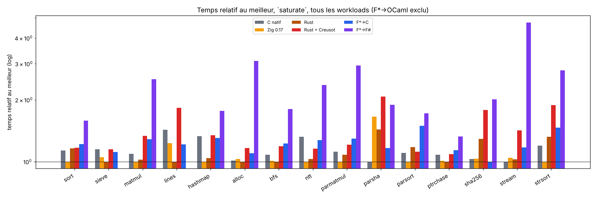
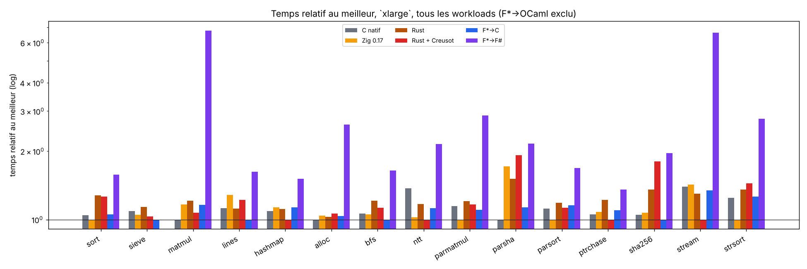
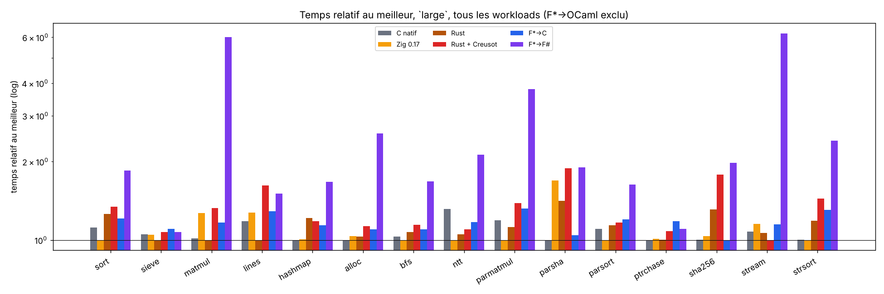
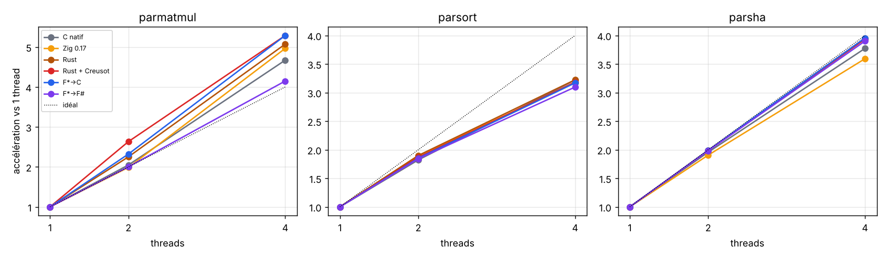
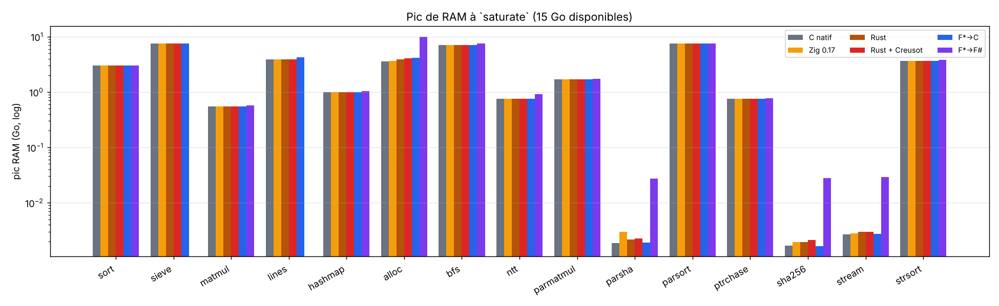
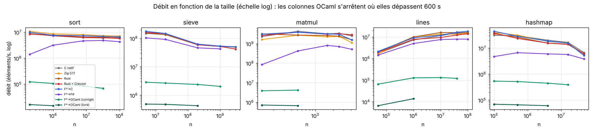
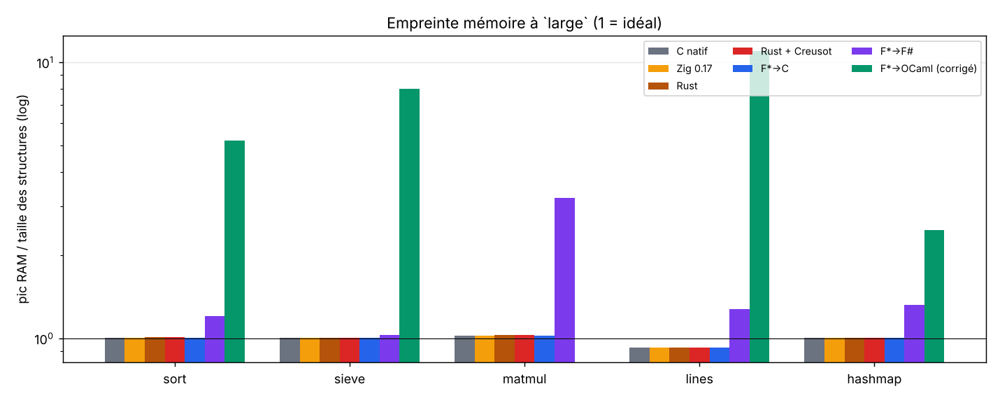
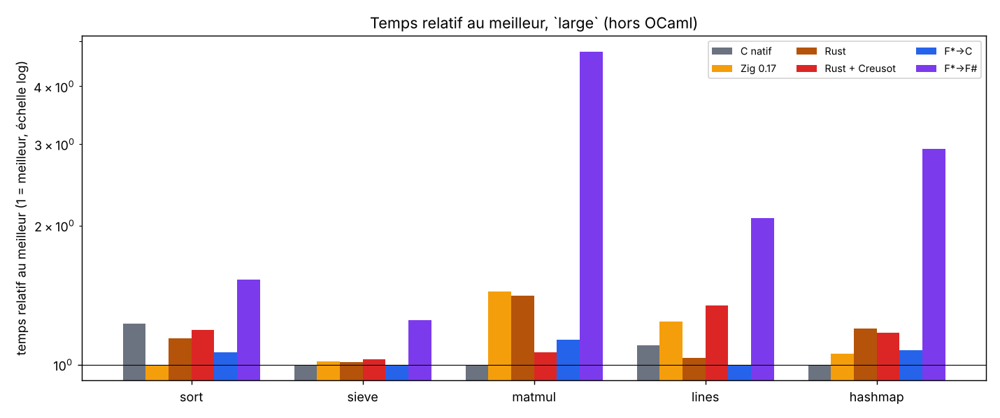
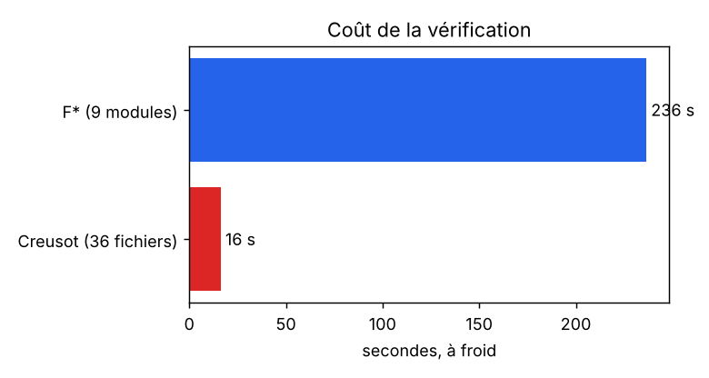

# Programmation vérifiée : F* (→ C, OCaml, F#) contre Rust + Creusot

Question : *« le code vérifié tient-il la route, en CPU, en RAM, en disque, et surtout en débit ? »*

Ce dépôt compare **huit colonnes**, sur **quinze workloads identiques** : 5 de base (spécification dans
[`spec/WORKLOADS.md`](spec/WORKLOADS.md)) et 10 « extrêmes » (`spec/workloads.d/*.md`, contrat commun dans [`spec/EXTENDED.md`](spec/EXTENDED.md)), avec un harnais de mesure externe (temps, CPU, pic RAM et courbe,
défauts de page, E/S disque, taille des binaires, coût de démarrage). Chaque colonne doit produire le **même
checksum** ; sinon le résultat est marqué ❌.

| colonne | source | vérifiée ? | extraction / compilation |
|---|---|---|---|
| `fstar-c` | `fstar/src/*.fst` (Pulse) | **oui (F\*)** | `fstar.exe --codegen C` → `gcc -O3` |
| `fstar-fsharp` | **les mêmes** sources F* | oui | `fstar.exe --codegen FSharp` → .NET 10 |
| `fstar-ocaml` / `fstar-ocaml-fast` | **les mêmes** sources F* | oui | `fstar.exe --codegen OCaml` → `ocamlopt` (runtime livré / conversions corrigées) |
| `rust-creusot` | `impls/rust` (Rust annoté Creusot) | **oui (Creusot)** | `cargo build --release` (les contrats sont effacés) |
| `rust-plain` | `impls/rust-plain` (Rust idiomatique, sans Creusot) | non | `cargo build --release` (opt 3, LTO, `panic=abort`) |
| `c-native` | `impls/c-native/bench.c` (C11 écrit à la main) | non | `gcc -O3 -std=c11` |
| `zig` | `impls/zig/bench.zig` (**Zig 0.17.0**, à la main) | non | `zig build-exe -O ReleaseFast -lc` |

Les trois colonnes **non vérifiées** (`rust-plain`, `c-native`, `zig`) sont des *références* demandées explicitement :
même algorithme, mêmes graines, même checksum, écrites sans preuve. Elles servent à répondre à « combien coûte le fait de
passer par F* ou par Creusot ? » en comparant à ce qu'on obtient sans. Les colonnes F* restent **100 % générées** (aucune
implémentation F* écrite à la main dans un autre langage).

## Réponses aux deux questions de fond

### « Pourquoi des implémentations à la main ? »

Dans une version précédente j'avais mis des ports « à la main » de F\* en OCaml/F#/C à la place des extractions ; vous aviez
(à raison) refusé : les colonnes F\* → C / F# / OCaml sont maintenant **toutes générées par F\*** à partir des mêmes
sources vérifiées. Les trois colonnes à la main d'aujourd'hui sont d'une autre nature, et demandées par vous : un **C natif**, un
**Zig 0.17** et un **Rust sans Creusot**, comme *références* de ce qu'un programmeur obtient sans vérification. Un seul
oracle de checksums existe aussi aux petites tailles ([`spec/checksums.json`](spec/checksums.json)).

### « Que veut dire Rust + contrats Creusot ? »

* **Creusot** est un outil de *vérification déductive* pour Rust. On écrit dans le code Rust des **contrats** :
  `#[requires(…)]` (précondition), `#[ensures(…)]` (postcondition), `#[invariant(…)]` (invariant de boucle),
  `#[variant(…)]` (terminaison), et des fonctions de spécification en logique (`#[logic]`). `cargo creusot`
  traduit le MIR en Why3/Coma, génère des obligations de preuve et les confie à des solveurs SMT
  (Alt-Ergo, Z3, CVC4/5).
* Un `cargo build` ordinaire **ignore** ces annotations : le binaire est du Rust normal. Le surcoût à l'exécution
  vient uniquement des choix de code que la preuve impose, jamais des preuves elles-mêmes.
* Ce qui est **réellement prouvé** ici (`make creusot`, voir « Niveau de preuve »): absence de panique et de
  débordement arithmétique pour tout le crate, terminaison de tout ce qui n'alloue pas, et — pour le tri —
  la **correction fonctionnelle complète** (le résultat est trié *et* est une permutation de l'entrée, rien
  d'autre n'est modifié). Les preuves sont exécutées (Alt-Ergo/Z3/CVC5) : un invariant affaibli fait échouer le
  but correspondant, je l'ai vérifié.
* Dans la version précédente du dépôt, les contrats étaient écrits mais **jamais prouvés** (Creusot n'était pas
  installé). Ce n'est plus le cas.

## Niveau de preuve (ce qui est démontré, et ce qui ne l'est pas)

| workload | F* (Pulse) | Rust (Creusot) |
|---|---|---|
| `sort` | **fonctionnel complet** : trié ∧ permutation ∧ cadre ; mémoire, débordements, terminaison | **fonctionnel complet** (idem) ; terminaison sauf l'allocation |
| `sieve` | mémoire sûre, indices, débordements, terminaison | idem |
| `matmul` | idem + indices non linéaires `i·n+j < n²` | idem |
| `lines` | idem ; l'analyseur est gardé par `p < len` | idem |
| `hashmap` | idem ; sondage borné par `cap` essais | idem |

**Limites assumées.** Hors du tri, je n'ai pas prouvé la correction « métier » (crible = nombres premiers,
produit matriciel = somme des produits, table = dictionnaire, analyse de lignes = somme par clé). Ce sont des
preuves de plusieurs jours chacune ; elles n'ajouteraient pas une instruction au code généré, seulement du temps
de preuve. Le checksum, comparé entre les huit colonnes, tient lieu de test de non-régression pour ces quatre-là.
Les corps de `mix64` et `ckfold` sont des opérations modulo 2^64 sans contrat.

## Workloads extrêmes (10 de plus, pour pousser chaque chaîne dans ses retranchements)

Les 5 workloads de base sont mono-thread, sur tableaux, sans fichier : ils ne départagent plus les colonnes natives. Dix workloads ont donc été ajoutés
(mêmes 8 colonnes, **même checksum partout**, preset `saturate` dimensionné pour approcher les limites de la machine : 4 cœurs, 15 Go de RAM, 18 Go de disque).

| workload | ce qu'il stresse | taille `saturate` | preuve (F* Pulse et Creusot) | choix et écarts de spécification |
|---|---|---|---|---|
| `sha256` | CPU, arithmétique 32 bits dense | 4·10¹⁰ octets hachés | mémoire-sûreté, bornes, pas de débordement ; **pas** de correction fonctionnelle (le C est validé contre `sha256sum` pour n ∈ {0, 1, 55, 56, 63, 64, 65, 119, 120, 127, 128, 1000, 10⁶}) | message généré à la volée (pas de tampon géant) ; rotations écrites en décalages (Creusot n'a pas de contrat pour `rotate_right`) |
| `ntt` | accès à pas variable (analogue entier de la FFT) | n = 2²⁷ (1 Go + 0,5 Go de racines) | mémoire-sûreté, bornes d'indices | p = 2013265921 (et non 998244353 : n ≤ 2²³ seulement) ; **entier** car F* n'extrait pas proprement les flottants |
| `bfs` | accès irréguliers (graphe CSR de 1,6·10⁹ arêtes) | 10⁸ sommets (7,2 Go) | mémoire-sûreté ; gardes runtime `e<m`, `v<n`, … dans F* et Creusot | construction du graphe comprise dans le temps mesuré |
| `strsort` | chaînes de longueur variable, comparaisons indirectes | 1,2·10⁸ chaînes (3,7 Go) | mémoire-sûreté ; gardes runtime dans les colonnes vérifiées seulement | tri fusion **stable** des indices |
| `ptrchase` | latence mémoire (arbre de recherche + chasse de pointeurs) | 4·10⁷ nœuds | mémoire-sûreté ; gardes runtime dans les colonnes vérifiées seulement | **arène par indices, pas de vrais pointeurs de tas** : une preuve de séparation sur des nœuds alloués est hors de portée |
| `alloc` | allocateur / GC : 1,6·10⁹ allocations de 8 à 256 octets + fenêtre vivante FIFO | 1,6·10⁹ | **F\* : preuve d'ownership de chaque bloc (pas de fuite, pas de double libération)** ; Creusot : sûreté, un seul `#[trusted]` (`black_box`) | largeur des emplacements de la fenêtre différente selon les colonnes (8 à 24 o) : documentée dans la spec |
| `stream` | **E/S disque réelles** : JSON-lines de 8 Gio lus par blocs de 1 Mio (CRC-32 + tokeniseur) | 8 192 Mio | noyau `chunk` prouvé (mémoire-sûreté) ; **lecture du fichier non prouvée** (pilotes C/F#/OCaml ; `run` Creusot `#[trusted]`) | cache de pages vidé avant chaque run ; fichier généré hors du temps mesuré |
| `parmatmul`, `parsort`, `parsha` | **multi-thread** (4 threads) | n = 12 288 ; 10⁹ éléments ; 6,4·10¹⁰ octets | noyaux séquentiels prouvés par plage ; **les threads sont dans du code non prouvé** (pilotes pour F*, wrapper `#[trusted]` pour Creusot) | `parmatmul`/`parsort` ont le même checksum que `matmul`/`sort` ; celui de `parsha` dépend du nombre de threads |

Ce qui n'a **pas** pu être fait dans F* : les flottants (d'où `ntt` entière), de vrais pointeurs de tas pour `ptrchase`, de la concurrence prouvée (les threads
sont dans les pilotes). Aucune colonne n'est « non implémentée » : les 8 colonnes tournent sur les 15 workloads.

## Ce que fait réellement F* 2026.10.25 (constats)

F* a changé : `LowStar.Buffer`/KaRaMeL ont disparu de la ulib ; la programmation de bas niveau passe par
**Pulse** (logique de séparation, `Pulse.Lib.Vec`, boucles `while` avec invariants) et l'extracteur
**Custard** (extraction « programme entier », monomorphisante).

* **C** : Custard produit directement du C11 autonome (boucles `while`, `malloc`/`free`, aucun runtime). Sur le
  tri et le crible, c'est exactement le C qu'on écrirait à la main.
* **F#** : les entiers machine deviennent les types .NET natifs (`uint32`, `uint64`, `byte[]`), sans bibliothèque de
  support. C'est le backend le plus proche du C en sémantique ; il refuse tout `Prims.int` à l'exécution.
* **OCaml** : le backend OCaml, lui, conserve le modèle de la bibliothèque F* : `FStar_SizeT.t` est un type boxé
  (`Sz of FStar_UInt64.t`, lui-même un `Stdint.Uint64.t`), les index passent par `Z.to_int (FStar_SizeT.v p)`,
  et **`FStar_UIntN.v` convertit l'entier en chaîne décimale puis la reparse avec Zarith**
  (`Prims.parse_int (M.to_string x)`), de même pour `uint_to_t`. C'est la cause principale de la lenteur : chaque
  accès tableau fait un aller-retour par une chaîne de caractères. D'où deux colonnes :
  * `fstar-ocaml` : runtime exactement tel que livré (compilé depuis `ulib/ml` ; les `.cmxa` précompilés exigent une
    variante exacte d'OCaml 5.3, rejetée par un OCaml standard) ;
  * `fstar-ocaml-fast` : **mêmes sources extraites**, seules `v` et `uint_to_t` remplacées par des conversions
    directes (`fstar/ocaml/build-ocaml.sh fast`).
  Un essai avec flambda (`-O3`) change les temps de ±20 % dans les deux sens : pas de colonne dédiée.
* **Bibliothèque** : la bibliothèque Pulse fournit un tri fusion vérifié (`Pulse.Lib.Sort.Merge.*`) et une table de
  hachage vérifiée (`Pulse.Lib.HashTable`). Je les ai examinées et **n'ai pas pu utiliser le tri** : sa
  spécification (`spec_merge`) renvoie `false` dès que deux éléments se comparent égaux, donc il ne trie que des
  clés toutes distinctes ; mon workload (8 M de u32 aléatoires) contient des doublons. J'ai donc écrit un tri
  fusion de même nature mais avec doublons. `Pulse.Lib.Vec`, `FStar.SizeT`, `FStar.Seq.Properties`
  (`permutation`, `append_permutations`, …) et `FStar.Math.Lemmas` sont, eux, utilisés.

## Mise en route

```bash
scripts/setup-fstar.sh      # F* 2026.10.25, .NET 10, switch opam OCaml 5.3 (stdint, zarith, ppx_deriving...)
scripts/setup-creusot.sh    # Creusot (clone, opam, solveurs, cargo-creusot)
scripts/setup-zig.sh        # Zig 0.17.0 (sha256 vérifié) dans /opt/tools/zig

scripts/build-all.sh        # Rust (x2), C natif, Zig + F* -> C, F#, OCaml ; écrit results/footprint.json
make creusot                # preuves Creusot (durée enregistrée)
fstar/build.sh verify       # preuves F* (durée enregistrée)

python3 harness/bench.py list
python3 harness/bench.py run --preset medium --repeat 3 --out results/run-medium.json  # + .md/.html/.csv
python3 harness/bench.py run --preset small --impls fstar-ocaml --timeout 600 --out results/run-small-fstar-ocaml.json
python3 harness/readme_tables.py     # régénère les tableaux de la section Résultats
```

Presets : `smoke`, `tiny`, `small`, `medium`, `large`, `xlarge` (voir `harness/presets.json`). Options :
`--repeat N`, `--timeout S`, `--impls a,b`, `--workloads w,…`, `--wrapper "taskset -c 2"` ou
`--wrapper "systemd-run --scope -p MemoryMax=2G --user"` pour plafonner la RAM.

## Organisation

```
spec/WORKLOADS.md        les 5 workloads de base (algorithmes, graines, checksums, tailles) ; spec/checksums.json
spec/workloads.d, spec/checksums.d, harness/presets.d   les 10 workloads extrêmes : spécification, checksums, tailles par preset
harness/bench.py         lanceur + mesures + rapport ; runner.c (fork/exec/wait4) ; impls.json ; presets.json
impls/rust               crate Rust + contrats Creusot (src/{common,sort,sieve,matmul,lines,hashmap}.rs)
impls/rust-plain         même algorithmes en Rust idiomatique, sans Creusot (src/main.rs)
impls/c-native           C11 écrit à la main (bench.c)
impls/zig                Zig 0.17 écrit à la main (bench.zig)
fstar/src                Bench.{Common,SortSpec,Sort,Sieve,Matmul,Lines,Hashmap,All}.fst(i) — Pulse
fstar/build.sh           verify -> extraction Custard -> C | F# | OCaml
fstar/ocaml/build-ocaml.sh   compile le code OCaml extrait avec le runtime F* (stock | fast)
fstar/drivers            pilotes C / F# / OCaml (parse des arguments, chronométrage, affichage)
scripts/                 installation et construction ; results/ : sorties
```

## Méthodologie de mesure

* **Débit** : mesuré *dans* le processus autour du calcul (hors démarrage du runtime) ; le démarrage est rapporté
  à part (run minuscule, médiane de 3).
* **CPU / RAM / disque** : mesurés par un petit lanceur C (`harness/runner.c`) qui fait `fork`/`exec`/`wait4`
  (user, sys, `ru_maxrss`, défauts de page, blocs E/S) plus un échantillonneur `/proc/<pid>` toutes les 20 ms
  (courbe de RSS). Le lanceur est nécessaire : `ru_maxrss` d'un enfant hérite du RSS du parent au `fork`, ce qui
  ajoutait ~15 Mo de plancher parasite quand le parent était l'interpréteur Python.
* **RAM/idéal** = pic RSS ÷ taille des structures de la spécification (voir `spec/WORKLOADS.md`).
* Médiane de N exécutions ; checksums vérifiés entre chaînes et contre `spec/checksums.json` (✅/❌).
* Limites : une VM de 4 cœurs, pas d'épinglage ni de gouverneur CPU figé ; les comparaisons relatives sont fiables à
  quelques pourcents, pas les valeurs absolues. Aucun workload ne lit de fichier : le « disque » est mesuré par les
  compteurs d'E/S du noyau (nuls) et par la taille des binaires/runtimes.
* **Réglages pour la performance maximale** (appliqués à *toutes* les colonnes natives, par `scripts/build-all.sh` et `fstar/build.sh`) :
  `gcc -O3 -march=native` (C natif et F*→C) ; `rustc -C opt-level=3 -C target-cpu=native` + LTO, `codegen-units=1`, `panic=abort`
  (`.cargo/config.toml` des deux crates) ; Zig `-O ReleaseFast -mcpu=native` ; .NET 10 Release avec `TieredPGO` et
  `TieredCompilationQuickJitForLoops=false` (les boucles sont compilées en pleine optimisation d'emblée : sans cela `matmul`
  était ~30 % plus lent, mesuré) ; OCaml `ocamlopt -inline 200 -unsafe` (sans flambda : ±20 %, pas de colonne dédiée). Le CPU de la
  machine a AVX2 et AVX-512 : les binaires natifs ne sont **pas portables** vers une machine plus ancienne. Toutes les colonnes natives
  sont épinglées sur un cœur (`taskset -c 1`) pour éviter les migrations. Le premier jeu de mesures utilisait une cible x86-64
  générique ; passer en `-march=native` a, par exemple, divisé par ~1,8 le temps de `matmul` en C et en Rust.
* **Zig, `matmul`** : la version idiomatique (`for (crow, brow) |*c, b| c.* += a*b`) n'était pas auto-vectorisée par LLVM (2,3 G/s à `large`,
  contre 6 en C) ; j'ai écrit la boucle interne avec `@Vector(16, u32)` et `noalias` (4,9 G/s). C'est le seul endroit où j'ai adapté le code à un
  compilateur ; le checksum est inchangé.

## Résultats

Machine : VM de 4 cœurs (Xeon 2,1 GHz, AVX2/AVX-512), 15 Go de RAM, 18 Go de disque utilisable, pas de swap par défaut. Chaque cellule : débit · durée interne · pic RAM.
Colonnes natives : médiane de 3 exécutions jusqu'à `large` (2 pour les workloads étendus à `large`), 1 exécution à `xlarge` et `saturate` ; **épinglées sur un cœur**
(`taskset -c 1`) sauf les workloads multi-thread (4 threads, non épinglés) ; binaires compilés pour le CPU de la machine. OCaml : 1 exécution, épinglé sur un autre cœur, délai
de 600 s (300 s pour les workloads étendus). **1529 exécutions au total : 1489 réussies, 36 délais dépassés, 4 échecs, aucun checksum divergent** entre colonnes ni avec les tables de référence.
Rapports complets : `results/run-*.{md,html,csv}` ; tous les tableaux par taille : [`results/tables.md`](results/tables.md).

### Taille `saturate` : la machine poussée à ses limites

Pics observés : **10,2 Go de RAM** (`alloc` en F#), 7,6 Go (`sieve`, `parsort`), **4 cœurs à ~100 %** (workloads parallèles, jusqu'à 2 282 s de CPU en une seule exécution F#), **8 Go lus sur disque**
(`stream`, 16,8 M de blocs), puis, dans le mode « dépassement de RAM » ci-dessous, 8 Go de swap occupés et 20 M de fautes de page majeures.

#### `saturate`

| workload (n) | C natif | Zig 0.17 | Rust | Rust + Creusot | F*→C | F*→F# |
|---|--:|--:|--:|--:|--:|--:|
| sort (400 000 000) | 4.79 M/s · 83.44 s · 3053 Mo | 5.44 M/s · 73.55 s · 3054 Mo | 4.68 M/s · 85.47 s · 3054 Mo | 4.66 M/s · 85.84 s · 3054 Mo | 4.47 M/s · 89.54 s · 3053 Mo | 3.43 M/s · 116.49 s · 3080 Mo |
| sieve (8 000 000 000) | 44.06 M/s · 181.57 s · 7631 Mo | 48.25 M/s · 165.82 s · 7631 Mo | 50.64 M/s · 157.99 s · 7631 Mo | 44.07 M/s · 181.55 s · 7631 Mo | 45.52 M/s · 175.76 s · 7631 Mo | **échec** |
| matmul (7 000) | 1.96 G/s · 175.45 s · 562 Mo | 2.13 G/s · 160.81 s · 563 Mo | 2.08 G/s · 164.67 s · 563 Mo | 1.60 G/s · 214.84 s · 563 Mo | 1.66 G/s · 206.86 s · 562 Mo | 847.62 M/s · 404.66 s · 589 Mo |
| lines (300 000 000) | 13.13 M/s · 22.85 s · 3974 Mo | 15.27 M/s · 19.65 s · 3974 Mo | 18.78 M/s · 15.97 s · 3975 Mo | 10.29 M/s · 29.14 s · 3975 Mo | 15.46 M/s · 19.40 s · 4309 Mo | **échec** |
| hashmap (60 000 000) | 3.31 M/s · 54.38 s · 1025 Mo | 4.40 M/s · 40.93 s · 1026 Mo | 4.23 M/s · 42.55 s · 1026 Mo | 3.28 M/s · 54.96 s · 1026 Mo | 3.38 M/s · 53.30 s · 1026 Mo | 2.49 M/s · 72.15 s · 1053 Mo |
| alloc (1 600 000 000) | 5.65 M/s · 283.27 s · 3684 Mo | 5.56 M/s · 287.74 s · 3754 Mo | 5.72 M/s · 279.82 s · 3945 Mo | 4.92 M/s · 325.33 s · 4135 Mo | 5.21 M/s · 307.14 s · 4234 Mo | 1.85 M/s · 865.08 s · 10196 Mo |
| bfs (100 000 000) | 20.84 M/s · 230.38 s · 7249 Mo | 22.28 M/s · 215.45 s · 7250 Mo | 22.47 M/s · 213.61 s · 7250 Mo | 18.91 M/s · 253.77 s · 7250 Mo | 18.31 M/s · 262.13 s · 7249 Mo | 12.48 M/s · 384.57 s · 7658 Mo |
| ntt (134 217 728) | 53.08 M/s · 68.27 s · 769 Mo | 70.20 M/s · 51.62 s · 770 Mo | 68.08 M/s · 53.23 s · 770 Mo | 60.62 M/s · 59.78 s · 770 Mo | 55.13 M/s · 65.74 s · 770 Mo | 29.72 M/s · 121.93 s · 927 Mo |
| parmatmul (12 288) | 8.36 G/s · 221.99 s · 1730 Mo | 9.35 G/s · 198.46 s · 1731 Mo | 8.64 G/s · 214.63 s · 1730 Mo | 7.72 G/s · 240.24 s · 1730 Mo | 7.22 G/s · 257.08 s · 1730 Mo | 3.18 G/s · 582.96 s · 1756 Mo |
| parsha (64 000 000 000) | 849.54 M/s · 75.34 s · 2 Mo | 513.53 M/s · 124.63 s · 3 Mo | 592.78 M/s · 107.97 s · 2 Mo | 409.62 M/s · 156.24 s · 2 Mo | 729.54 M/s · 87.73 s · 2 Mo | 450.01 M/s · 142.22 s · 28 Mo |
| parsort (1 000 000 000) | 14.17 M/s · 70.56 s · 7631 Mo | 15.63 M/s · 63.98 s · 7632 Mo | 13.28 M/s · 75.28 s · 7632 Mo | 14.00 M/s · 71.42 s · 7632 Mo | 10.47 M/s · 95.53 s · 7631 Mo | 9.09 M/s · 110.00 s · 7658 Mo |
| ptrchase (40 000 000) | 1.14 M/s · 263.37 s · 764 Mo | 1.22 M/s · 246.12 s · 765 Mo | 1.23 M/s · 243.75 s · 765 Mo | 1.13 M/s · 265.15 s · 765 Mo | 1.08 M/s · 276.85 s · 764 Mo | 930.12 k/s · 322.54 s · 792 Mo |
| sha256 (40 000 000 000) | 202.12 M/s · 197.90 s · 2 Mo | 201.43 M/s · 198.58 s · 2 Mo | 161.29 M/s · 248.00 s · 2 Mo | 116.59 M/s · 343.09 s · 2 Mo | 208.24 M/s · 192.08 s · 2 Mo | 103.61 M/s · 386.06 s · 29 Mo |
| stream (8 192) | 133.04 M/s · 64.57 s · 3 Mo | 127.50 M/s · 67.37 s · 3 Mo | 129.57 M/s · 66.30 s · 3 Mo | 93.62 M/s · 91.76 s · 3 Mo | 113.36 M/s · 75.77 s · 3 Mo | 28.00 M/s · 306.74 s · 30 Mo |
| strsort (120 000 000) | 651.42 k/s · 184.21 s · 3721 Mo | 778.34 k/s · 154.17 s · 3721 Mo | 589.33 k/s · 203.62 s · 3721 Mo | 413.58 k/s · 290.15 s · 3721 Mo | 531.76 k/s · 225.67 s · 3721 Mo | 279.62 k/s · 429.15 s · 3878 Mo |

Moyenne géométrique du temps relatif au meilleur : Zig 0.17 ×1.06 (15/15), Rust ×1.10 (15/15), C natif ×1.13 (15/15), F*→C ×1.22 (15/15), Rust + Creusot ×1.36 (15/15), F*→F# ×2.22 (13/15).

Les deux **échecs F#** à `saturate` (`sieve` 8·10⁹ octets, `lines` 4,5·10⁹ octets) sont les mêmes que celui de `xlarge` : le backend F# convertit la taille en entier 32 bits
(`Array.create` reçoit une valeur négative, ou l'index sort des bornes) ; le code extrait ne peut pas manipuler un tableau de plus de 2³¹−1 éléments. Le C extrait le fait sans souci.

### Taille `large`

#### `large`

| workload (n) | C natif | Zig 0.17 | Rust | Rust + Creusot | F*→C | F*→F# | F*→OCaml (corrigé) | F*→OCaml (livré) |
|---|--:|--:|--:|--:|--:|--:|--:|--:|
| sort (32 000 000) | 5.89 M/s · 5.43 s · 246 Mo | 6.58 M/s · 4.86 s · 246 Mo | 5.23 M/s · 6.12 s · 246 Mo | 4.90 M/s · 6.53 s · 246 Mo | 5.44 M/s · 5.89 s · 246 Mo | 3.56 M/s · 8.98 s · 273 Mo | 68.88 k/s · 464.57 s · 1267 Mo | délai dépassé |
| sieve (1 000 000 000) | 54.28 M/s · 18.42 s · 955 Mo | 54.53 M/s · 18.34 s · 955 Mo | 57.12 M/s · 17.51 s · 956 Mo | 53.19 M/s · 18.80 s · 956 Mo | 51.80 M/s · 19.30 s · 955 Mo | 53.32 M/s · 18.75 s · 983 Mo | 2.05 M/s · 487.39 s · 7648 Mo | délai dépassé |
| matmul (2 500) | 6.13 G/s · 2.55 s · 73 Mo | 4.91 G/s · 3.18 s · 73 Mo | 6.22 G/s · 2.51 s · 73 Mo | 4.70 G/s · 3.32 s · 73 Mo | 5.33 G/s · 2.93 s · 73 Mo | 1.04 G/s · 15.09 s · 101 Mo | délai dépassé | délai dépassé |
| lines (40 000 000) | 11.24 M/s · 3.56 s · 545 Mo | 10.42 M/s · 3.84 s · 545 Mo | 13.27 M/s · 3.01 s · 546 Mo | 8.21 M/s · 4.87 s · 546 Mo | 10.28 M/s · 3.89 s · 545 Mo | 8.80 M/s · 4.55 s · 617 Mo | 121.47 k/s · 329.29 s · 6469 Mo | délai dépassé |
| hashmap (16 000 000) | 17.14 M/s · 2.80 s · 513 Mo | 17.03 M/s · 2.82 s · 514 Mo | 14.11 M/s · 3.40 s · 514 Mo | 14.53 M/s · 3.30 s · 514 Mo | 15.06 M/s · 3.19 s · 514 Mo | 10.27 M/s · 4.68 s · 541 Mo | 392.43 k/s · 122.31 s · 1259 Mo | délai dépassé |
| alloc (100 000 000) | 6.14 M/s · 16.28 s · 232 Mo | 5.94 M/s · 16.84 s · 237 Mo | 5.96 M/s · 16.78 s · 249 Mo | 5.44 M/s · 18.37 s · 261 Mo | 5.60 M/s · 17.85 s · 266 Mo | 2.39 M/s · 41.76 s · 1015 Mo | — | — |
| bfs (15 000 000) | 36.74 M/s · 19.60 s · 1089 Mo | 37.83 M/s · 19.03 s · 1089 Mo | 35.30 M/s · 20.39 s · 1089 Mo | 33.14 M/s · 21.72 s · 1089 Mo | 34.49 M/s · 20.87 s · 1089 Mo | 22.57 M/s · 31.90 s · 1173 Mo | — | — |
| ntt (33 554 432) | 72.97 M/s · 11.50 s · 193 Mo | 96.14 M/s · 8.73 s · 194 Mo | 91.36 M/s · 9.18 s · 194 Mo | 87.44 M/s · 9.59 s · 194 Mo | 82.13 M/s · 10.21 s · 194 Mo | 45.21 M/s · 18.55 s · 350 Mo | — | — |
| parmatmul (6 144) | 11.68 G/s · 19.85 s · 434 Mo | 13.91 G/s · 16.67 s · 435 Mo | 12.41 G/s · 18.69 s · 434 Mo | 10.03 G/s · 23.13 s · 434 Mo | 10.54 G/s · 22.00 s · 434 Mo | 3.67 G/s · 63.14 s · 460 Mo | — | — |
| parsha (5 120 000 000) | 868.19 M/s · 5.90 s · 2 Mo | 514.27 M/s · 9.96 s · 3 Mo | 613.48 M/s · 8.35 s · 2 Mo | 459.85 M/s · 11.13 s · 2 Mo | 831.46 M/s · 6.16 s · 2 Mo | 457.70 M/s · 11.19 s · 28 Mo | — | — |
| parsort (100 000 000) | 17.33 M/s · 5.77 s · 765 Mo | 19.13 M/s · 5.23 s · 766 Mo | 16.80 M/s · 5.95 s · 765 Mo | 16.37 M/s · 6.11 s · 765 Mo | 15.93 M/s · 6.28 s · 765 Mo | 11.74 M/s · 8.52 s · 791 Mo | — | — |
| ptrchase (4 000 000) | 2.67 M/s · 11.22 s · 78 Mo | 2.64 M/s · 11.36 s · 78 Mo | 2.67 M/s · 11.24 s · 78 Mo | 2.47 M/s · 12.15 s · 78 Mo | 2.26 M/s · 13.27 s · 78 Mo | 2.42 M/s · 12.39 s · 105 Mo | — | — |
| sha256 (2 000 000 000) | 214.54 M/s · 9.32 s · 2 Mo | 207.30 M/s · 9.65 s · 2 Mo | 163.88 M/s · 12.20 s · 2 Mo | 120.46 M/s · 16.60 s · 2 Mo | 214.69 M/s · 9.32 s · 2 Mo | 108.81 M/s · 18.38 s · 28 Mo | — | — |
| stream (4 096) | 167.97 M/s · 25.57 s · 3 Mo | 156.94 M/s · 27.37 s · 3 Mo | 170.01 M/s · 25.26 s · 3 Mo | 180.57 M/s · 23.79 s · 3 Mo | 156.99 M/s · 27.36 s · 3 Mo | 29.14 M/s · 147.39 s · 30 Mo | — | — |
| strsort (8 000 000) | 1.27 M/s · 6.30 s · 249 Mo | 1.27 M/s · 6.28 s · 250 Mo | 1.08 M/s · 7.44 s · 250 Mo | 883.36 k/s · 9.06 s · 250 Mo | 975.06 k/s · 8.20 s · 249 Mo | 530.38 k/s · 15.08 s · 406 Mo | — | — |

Moyenne géométrique du temps relatif au meilleur : C natif ×1.07 (15/15), Zig 0.17 ×1.09 (15/15), Rust ×1.12 (15/15), F*→C ×1.16 (15/15), Rust + Creusot ×1.29 (15/15), F*→F# ×2.16 (15/15), F*→OCaml (corrigé) ×59.68 (4/15).

Les autres tailles (`xlarge`, `medium`, `small`, `tiny`, avec les colonnes OCaml là où elles terminent) sont dans [`results/tables.md`](results/tables.md).

## Synthèse des performances et graphes

Temps relatif au meilleur de la ligne, taille `saturate` (1,00 = meilleur) :

| workload | n | C natif | Zig 0.17 | Rust | Rust + Creusot | F*→C | F*→F# |
|---|--:|--:|--:|--:|--:|--:|--:|
| sort | 400 000 000 | ×1.13 | ×1.00 | ×1.16 | ×1.17 | ×1.22 | ×1.58 |
| sieve | 8 000 000 000 | ×1.15 | ×1.05 | ×1.00 | ×1.15 | ×1.11 | **échec** |
| matmul | 7 000 | ×1.09 | ×1.00 | ×1.02 | ×1.34 | ×1.29 | ×2.52 |
| lines | 300 000 000 | ×1.43 | ×1.23 | ×1.00 | ×1.82 | ×1.21 | **échec** |
| hashmap | 60 000 000 | ×1.33 | ×1.00 | ×1.04 | ×1.34 | ×1.30 | ×1.76 |
| alloc | 1 600 000 000 | ×1.01 | ×1.03 | ×1.00 | ×1.16 | ×1.10 | ×3.09 |
| bfs | 100 000 000 | ×1.08 | ×1.01 | ×1.00 | ×1.19 | ×1.23 | ×1.80 |
| ntt | 134 217 728 | ×1.32 | ×1.00 | ×1.03 | ×1.16 | ×1.27 | ×2.36 |
| parmatmul | 12 288 | ×1.12 | ×1.00 | ×1.08 | ×1.21 | ×1.30 | ×2.94 |
| parsha | 64 000 000 000 | ×1.00 | ×1.65 | ×1.43 | ×2.07 | ×1.16 | ×1.89 |
| parsort | 1 000 000 000 | ×1.10 | ×1.00 | ×1.18 | ×1.12 | ×1.49 | ×1.72 |
| ptrchase | 40 000 000 | ×1.08 | ×1.01 | ×1.00 | ×1.09 | ×1.14 | ×1.32 |
| sha256 | 40 000 000 000 | ×1.03 | ×1.03 | ×1.29 | ×1.79 | ×1.00 | ×2.01 |
| stream | 8 192 | ×1.00 | ×1.04 | ×1.03 | ×1.42 | ×1.17 | ×4.75 |
| strsort | 120 000 000 | ×1.19 | ×1.00 | ×1.32 | ×1.88 | ×1.46 | ×2.78 |

Moyennes géométriques à `saturate` (15 workloads ; F# sur 13 : ses deux échecs ne comptent pas) : voir la dernière ligne du tableau `saturate` ci-dessus. En moyenne géométrique
sur les 15 workloads : **Rust + Creusot / Rust simple = ×1.24** (plus lent sur 14 workloads sur 15, de ×0.95 à ×1.82) ; **F*→C / C natif = ×1.08** ; **F*→F# / C natif = ×2.00** (sur 13).

> **F\* → OCaml est absent de tous les graphes** : il est de ×26 à ×1000 plus lent que le meilleur selon la taille, dépasse le délai sur la plupart des workloads dès `medium`, et consomme jusqu'à ×11 la
> RAM idéale ; sur la même échelle il écrase les autres courbes. Ses chiffres sont dans [`results/tables.md`](results/tables.md).

1. **Temps relatif au meilleur, `saturate`, 15 workloads** (échelle log ; une barre F# absente = échec, `sieve` et `lines`).
   
2. **Idem à `xlarge` et à `large`.**
   
   
3. **Passage à l'échelle multi-thread** (1, 2, 4 threads, taille `large`) : accélération contre l'idéal.
   
4. **Pic de RAM à `saturate`** (échelle log, en Go).
   
5. **Débit selon la taille** (5 workloads de base), **mémoire à `large`**, **temps relatif `large` des 5 de base**, **coût de la vérification** :
   
   
   
   

### Passage à l'échelle : 1, 2 et 4 threads

Temps · accélération contre 1 thread, taille `large` (`parmatmul` n = 6 144, `parsort` 10⁸, `parsha` 5,12·10⁹ octets).

#### Passage à l'échelle (taille `large`) : temps · accélération vs 1 thread

| workload | threads | C natif | Zig 0.17 | Rust | Rust + Creusot | F*→C | F*→F# |
|---|--:|--:|--:|--:|--:|--:|--:|
| parmatmul | 1 | 117.0 s · ×1.00 | 109.7 s · ×1.00 | 111.2 s · ×1.00 | 114.1 s · ×1.00 | 111.3 s · ×1.00 | 260.8 s · ×1.00 |
| parmatmul | 2 | 57.1 s · ×2.05 | 55.2 s · ×1.99 | 49.4 s · ×2.25 | 43.3 s · ×2.63 | 47.9 s · ×2.32 | 130.2 s · ×2.00 |
| parmatmul | 4 | 25.0 s · ×4.67 | 22.1 s · ×4.97 | 21.9 s · ×5.07 | 21.6 s · ×5.29 | 21.1 s · ×5.29 | 62.9 s · ×4.15 |
| parsort | 1 | 18.8 s · ×1.00 | 16.9 s · ×1.00 | 19.4 s · ×1.00 | 19.3 s · ×1.00 | 19.4 s · ×1.00 | 26.2 s · ×1.00 |
| parsort | 2 | 10.3 s · ×1.82 | 8.9 s · ×1.90 | 10.2 s · ×1.90 | 10.4 s · ×1.87 | 10.5 s · ×1.85 | 14.2 s · ×1.84 |
| parsort | 4 | 5.8 s · ×3.22 | 5.3 s · ×3.17 | 6.0 s · ×3.22 | 6.1 s · ×3.18 | 6.1 s · ×3.17 | 8.5 s · ×3.10 |
| parsha | 1 | 23.2 s · ×1.00 | 37.5 s · ×1.00 | 33.2 s · ×1.00 | 44.2 s · ×1.00 | 23.6 s · ×1.00 | 43.1 s · ×1.00 |
| parsha | 2 | 11.9 s · ×1.96 | 19.7 s · ×1.91 | 16.8 s · ×1.98 | 22.2 s · ×1.99 | 11.9 s · ×1.99 | 21.8 s · ×1.98 |
| parsha | 4 | 6.1 s · ×3.77 | 10.4 s · ×3.59 | 8.4 s · ×3.95 | 11.2 s · ×3.94 | 6.0 s · ×3.96 | 11.1 s · ×3.90 |


`parsort` plafonne à ×3,1–3,2 (la dernière fusion est séquentielle : loi d'Amdahl, et bande passante mémoire) ; `parsha` (calcul pur) atteint ×3,6 à ×4,0 ; `parmatmul` dépasse l'idéal
(×4,2 à ×5,3 à 4 threads) : le run à 1 thread est pénalisé, hypothèse non mesurée : l'ensemble de travail d'un seul cœur ne tient pas dans ses caches alors que chaque thread n'en garde qu'un quart.
Toutes les colonnes passent à l'échelle de façon comparable : le langage ne change pas le parallélisme ici, puisque les threads sont dans les pilotes.

### Dépassement de RAM (swap) : `lines`, `bfs`, `parsort`, `sieve`

Un lest de 11 Go est verrouillé en RAM (`mlock`, `harness/ballast.c`, option `--ballast 11G`) et 8 Go de swap sont activés (`scripts/swap.sh on 8`) : il reste **~4,7 Go de RAM réelle** (le pic RSS mesuré plafonne à
2,4 Go) pour des travaux de 4 à 7,6 Go. Une exécution par cellule, délai de 1 200 s (1 800 s pour `sieve` en C).

| workload | colonne | RAM normale | temps normal | temps avec 4,7 Go de RAM libre + 8 Go de swap | facteur | fautes de page majeures | lecture swap |
|---|---|--:|--:|--:|--:|--:|--:|
| bfs | C natif | 7.1 Go | 230 s | > 1201 s (délai) | > ×5 | 19.1 M | 73 Go |
| bfs | Zig 0.17 | 7.1 Go | 215 s | > 1201 s (délai) | > ×6 | 20.2 M | 77 Go |
| bfs | Rust | 7.1 Go | 214 s | > 1201 s (délai) | > ×6 | 20.0 M | 76 Go |
| bfs | Rust + Creusot | 7.1 Go | 254 s | > 1201 s (délai) | > ×5 | 19.5 M | 74 Go |
| bfs | F*→C | 7.1 Go | 262 s | > 1201 s (délai) | > ×5 | 20.2 M | 71 Go |
| lines | C natif | 3.9 Go | 23 s | 54 s | ×2.4 | 0.1 M | 4 Go |
| lines | Zig 0.17 | 3.9 Go | 20 s | 43 s | ×2.2 | 0.1 M | 4 Go |
| lines | Rust | 3.9 Go | 16 s | 44 s | ×2.8 | 0.1 M | 4 Go |
| lines | Rust + Creusot | 3.9 Go | 29 s | 52 s | ×1.8 | 0.1 M | 4 Go |
| lines | F*→C | 4.2 Go | 19 s | 52 s | ×2.7 | 0.3 M | 4 Go |
| parsort | C natif | 7.5 Go | 71 s | 615 s | ×8.7 | 12.4 M | 75 Go |
| parsort | Zig 0.17 | 7.5 Go | 64 s | 606 s | ×9.5 | 12.5 M | 72 Go |
| parsort | Rust | 7.5 Go | 75 s | 629 s | ×8.4 | 12.4 M | 76 Go |
| parsort | Rust + Creusot | 7.5 Go | 71 s | tué (SIGKILL ; OOM ?) | — | 0.8 M | 11 Go |
| parsort | F*→C | 7.5 Go | 96 s | 660 s | ×6.9 | 13.2 M | 72 Go |
| sieve | C natif | 7.5 Go | 182 s | > 1801 s (délai) | > ×10 | 21.9 M | 252 Go |
| sieve | Rust + Creusot | 7.5 Go | 182 s | > 1200 s (délai) | > ×7 | 13.3 M | 183 Go |
Lecture : `lines` (accès séquentiels) ne ralentit que d'un facteur ~2–3. `parsort` (fusions séquentielles) est ×7 à ×10 plus lent, avec des centaines de secondes de temps système passées à paginer. `bfs` (accès aléatoires) et
`sieve` (balayages à grand pas) **ne terminent pas** en 20–30 minutes alors qu'ils prennent 3 à 4 minutes avec toute la RAM : le temps est dominé par le swap, pas par la colonne
(`bfs` : les cinq colonnes testées échouent ; `sieve` : deux colonnes testées). Une exécution (**Rust + Creusot sur `parsort`**) a été **tuée par SIGKILL à 99 s** (statut `oom?` du harnais : très probablement l'OOM-killer sous pression mémoire, non confirmé) ; les quatre autres colonnes ont terminé ; F# et OCaml n'ont pas été testés dans ce mode (F# ne peut pas allouer `sieve` 8·10⁹ de toute façon).

## Empreinte : CPU, RAM, disque

Ces mesures existent pour chaque run (colonnes `CPU`, `pic RAM`, `RAM/idéal`, fautes de page, E/S disque dans chaque rapport `results/run-*.md`). Méthode : un lanceur C fait `fork`/`exec`/`wait4`
et lit user+sys, `ru_maxrss`, fautes de page et blocs d'E/S ; un échantillonneur lit `/proc/<pid>` toutes les 20 ms (courbe de RSS dans les rapports HTML). Tableau à `saturate` :

#### CPU et RAM, `saturate`

Cellule : temps CPU (user+sys) · utilisation d'un cœur · pic RAM (RSS) · RAM ÷ taille idéale des structures · fautes de page mineures.

| workload | C natif | Zig 0.17 | Rust | Rust + Creusot | F*→C | F*→F# |
|---|--:|--:|--:|--:|--:|--:|
| sort | 82.5 s · 99 % · 3053 Mo · ×1.00 · 781 k | 72.3 s · 98 % · 3054 Mo · ×1.00 · 781 k | 84.6 s · 99 % · 3054 Mo · ×1.00 · 781 k | 84.8 s · 99 % · 3054 Mo · ×1.00 · 781 k | 88.7 s · 99 % · 3053 Mo · ×1.00 · 781 k | 115.4 s · 99 % · 3080 Mo · ×1.01 · 783 k |
| sieve | 179.0 s · 99 % · 7631 Mo · ×1.00 · 1953 k | 163.5 s · 99 % · 7631 Mo · ×1.00 · 1953 k | 156.5 s · 99 % · 7631 Mo · ×1.00 · 1953 k | 179.5 s · 99 % · 7631 Mo · ×1.00 · 1953 k | 173.7 s · 99 % · 7631 Mo · ×1.00 · 1953 k | — |
| matmul | 173.4 s · 99 % · 562 Mo · ×1.00 · 192 k | 158.7 s · 99 % · 563 Mo · ×1.00 · 144 k | 162.8 s · 99 % · 563 Mo · ×1.00 · 192 k | 211.8 s · 99 % · 563 Mo · ×1.00 · 191 k | 203.9 s · 99 % · 562 Mo · ×1.00 · 144 k | 399.9 s · 99 % · 589 Mo · ×1.05 · 146 k |
| lines | 22.6 s · 99 % · 3974 Mo · ×0.92 · 1021 k | 19.4 s · 98 % · 3974 Mo · ×0.92 · 1021 k | 15.8 s · 99 % · 3975 Mo · ×0.92 · 1021 k | 28.7 s · 98 % · 3975 Mo · ×0.92 · 1021 k | 19.2 s · 99 % · 4309 Mo · ×1.00 · 1103 k | — |
| hashmap | 53.5 s · 98 % · 1025 Mo · ×0.50 · 524 k | 40.5 s · 99 % · 1026 Mo · ×0.50 · 262 k | 42.0 s · 99 % · 1026 Mo · ×0.50 · 524 k | 54.0 s · 98 % · 1026 Mo · ×0.50 · 524 k | 52.6 s · 99 % · 1026 Mo · ×0.50 · 262 k | 71.3 s · 99 % · 1053 Mo · ×0.51 · 264 k |
| alloc | 280.2 s · 99 % · 3684 Mo · ×1.10 · 943 k | 283.9 s · 99 % · 3754 Mo · ×1.12 · 961 k | 276.8 s · 99 % · 3945 Mo · ×1.18 · 1009 k | 321.6 s · 99 % · 4135 Mo · ×1.24 · 1058 k | 303.9 s · 99 % · 4234 Mo · ×1.27 · 1084 k | 856.3 s · 99 % · 10196 Mo · ×3.05 · 5824 k |
| bfs | 227.6 s · 99 % · 7249 Mo · ×1.06 · 1953 k | 212.7 s · 99 % · 7250 Mo · ×1.06 · 1953 k | 211.2 s · 99 % · 7250 Mo · ×1.06 · 1953 k | 250.7 s · 99 % · 7250 Mo · ×1.06 · 1953 k | 259.1 s · 99 % · 7249 Mo · ×1.06 · 1953 k | 380.7 s · 99 % · 7658 Mo · ×1.12 · 1955 k |
| ntt | 67.5 s · 99 % · 769 Mo · ×1.00 · 197 k | 50.9 s · 99 % · 770 Mo · ×1.00 · 197 k | 52.6 s · 99 % · 770 Mo · ×1.00 · 197 k | 59.0 s · 99 % · 770 Mo · ×1.00 · 197 k | 64.9 s · 99 % · 770 Mo · ×1.00 · 197 k | 120.6 s · 99 % · 927 Mo · ×1.21 · 232 k |
| parmatmul | 866.2 s · 390 % · 1730 Mo · ×1.00 · 590 k | 771.0 s · 388 % · 1731 Mo · ×1.00 · 443 k | 839.2 s · 391 % · 1730 Mo · ×1.00 · 590 k | 933.9 s · 389 % · 1730 Mo · ×1.00 · 578 k | 1003.0 s · 390 % · 1730 Mo · ×1.00 · 442 k | 2282.0 s · 391 % · 1756 Mo · ×1.02 · 444 k |
| parsha | 294.4 s · 391 % · 2 Mo · ×0.95 · 0 k | 481.1 s · 386 % · 3 Mo · ×1.53 · 0 k | 422.0 s · 391 % · 2 Mo · ×1.10 · 0 k | 610.8 s · 391 % · 2 Mo · ×1.15 · 0 k | 342.2 s · 390 % · 2 Mo · ×0.96 · 0 k | 555.0 s · 390 % · 28 Mo · ×14.08 · 2 k |
| parsort | 233.7 s · 331 % · 7631 Mo · ×1.00 · 1953 k | 209.2 s · 327 % · 7632 Mo · ×1.00 · 1953 k | 252.7 s · 336 % · 7632 Mo · ×1.00 · 1953 k | 231.9 s · 325 % · 7632 Mo · ×1.00 · 1953 k | 260.0 s · 272 % · 7631 Mo · ×1.00 · 1953 k | 321.0 s · 291 % · 7658 Mo · ×1.00 · 1955 k |
| ptrchase | 259.9 s · 99 % · 764 Mo · ×1.00 · 195 k | 243.2 s · 99 % · 765 Mo · ×1.00 · 196 k | 240.9 s · 99 % · 765 Mo · ×1.00 · 195 k | 262.2 s · 99 % · 765 Mo · ×1.00 · 195 k | 273.9 s · 99 % · 764 Mo · ×1.00 · 195 k | 318.7 s · 99 % · 792 Mo · ×1.04 · 197 k |
| sha256 | 195.7 s · 99 % · 2 Mo · ×1764.00 · 0 k | 196.0 s · 99 % · 2 Mo · ×2048.00 · 0 k | 245.3 s · 99 % · 2 Mo · ×2024.00 · 0 k | 338.7 s · 99 % · 2 Mo · ×2200.00 · 0 k | 190.4 s · 99 % · 2 Mo · ×1724.00 · 0 k | 381.4 s · 99 % · 29 Mo · ×29304.00 · 2 k |
| stream | 62.6 s · 97 % · 3 Mo · ×2.75 · 0 k | 65.6 s · 97 % · 3 Mo · ×2.86 · 0 k | 64.4 s · 97 % · 3 Mo · ×3.06 · 0 k | 88.6 s · 96 % · 3 Mo · ×3.07 · 0 k | 73.8 s · 97 % · 3 Mo · ×2.76 · 0 k | 303.1 s · 99 % · 30 Mo · ×29.64 · 2 k |
| strsort | 182.0 s · 99 % · 3721 Mo · ×0.99 · 952 k | 152.1 s · 99 % · 3721 Mo · ×0.99 · 952 k | 200.8 s · 99 % · 3721 Mo · ×0.99 · 952 k | 287.1 s · 99 % · 3721 Mo · ×0.99 · 952 k | 223.6 s · 99 % · 3721 Mo · ×0.99 · 952 k | 424.3 s · 99 % · 3878 Mo · ×1.03 · 987 k |

#### Empreinte disque, démarrage, construction

| colonne | exécutable | runtime à installer | démarrage (run minuscule) | RAM au démarrage | compilation | vérification à froid |
|---|--:|--:|--:|--:|--:|--:|
| C natif | 37 Ko | 0 Mo | 5 ms | 1.8 Mo | 0.8 s | — |
| Zig 0.17 | 3795 Ko | 0 Mo | 5 ms | 2.1 Mo | 18.1 s | — |
| Rust | 469 Ko | 0 Mo | 6 ms | 2.0 Mo | 0.1 s | — |
| Rust + Creusot | 472 Ko | 0 Mo | 5 ms | 2.1 Mo | 0.2 s | 38 s |
| F*→C | 55 Ko | 0 Mo | 7 ms | 1.7 Mo | 3.5 s | 429 s |
| F*→F# | 90 Ko | 72 Mo | 91 ms | 27.9 Mo | 9.6 s | 429 s |

Lecture :
* **CPU** : mono-thread partout sauf les trois workloads `par*` (4 cœurs, CPU ≈ 4× la durée). Pour `stream`, le temps système (~30 s sur 65 s en C) correspond aux lectures de 8 Go : **le disque n'est pas le goulot, le CPU l'est** (CRC + tokeniseur, ~130 Mo/s) ;
  en F# le temps utilisateur est de 260 s contre 33 s en C (cause non investiguée).
* **RAM** : C, Zig, Rust, Rust + Creusot et F*→C sont à ×1,00–1,03 de l'idéal ; F# ajoute ~30 Mo fixes et, sur `alloc`, **10,2 Go contre 3,7 Go** en C (×2,8 : le ramasse-miettes garde les blocs de la fenêtre vivante et le churn
  plus longtemps).
* **Disque** : seul `stream` lit : 16,8 M de blocs de 512 o (8 Gio) pour toutes les colonnes. Empreinte des exécutables : 20–66 Ko en C/Zig/F*→C, ~400 Ko en Rust, F# 50 Ko + 72 Mo de runtime .NET, OCaml ~5 Mo.

### Ce que disent ces chiffres (et ce qu'ils ne disent pas)

* **Le code vérifié coûte peu en F*→C, davantage en Rust + Creusot.** Sur les 15 workloads à `saturate` : Zig ×1,06, Rust ×1,10, C natif ×1,13, **F*→C ×1,22**, **Rust + Creusot ×1,36**, F# ×2,22 (en moyenne géométrique du temps relatif au meilleur).
  F*→C est à ×1.08 du C écrit à la main ; Rust + Creusot est à ×1.24 du Rust simple. Les contrats sont effacés (même format de binaire) : le surcoût vient du **code que la preuve impose**
  (boucles indicées, rotations en décalages, gardes `if` conservées par `rustc`), pas des preuves. Sur les tailles plus petites les deux se confondaient ; les tailles `saturate` rendent l'écart visible.
  Cause exacte non mesurée (pas d'inspection d'assembleur).
* **Les écarts les plus grands sont dans F#**, pas dans les colonnes natives : `stream` ×4,8, `alloc` ×3,1 (et ×2,8 de RAM), `parmatmul` ×2,6, `matmul` ×2,3 ; les deux échecs sur tableaux > 2³¹.
* **`ptrchase` gomme les différences** : latence mémoire dominante, toutes les colonnes sont à ±25 % (F# ×1,2) ; `bfs` aussi pour les colonnes natives (F# ×1,7).
* **Zig 0.17** est le plus rapide en moyenne sur les 15 workloads (×1,06), mais le plus lent sur `parsha` (×1,65 : le noyau SHA-256 est codé sans instructions dédiées, comme les autres, et LLVM le déroule moins bien que gcc ici — hypothèse).
* **F* → OCaml n'est pas utilisable pour de la charge** (entiers boxés, aller-retour par une chaîne décimale dans le runtime livré) : voir `results/tables.md` pour les tailles qu'il termine.
* **Coût de la preuve** : vérification à froid des 15 modules F* : **429 s** (au total, `make fstar-verify`) ; preuves Creusot (108 fichiers) : **38 s**. Ces durées ne changent pas une instruction de code généré.
* Ce que cette étude **ne montre pas** : l'effet de preuves fonctionnelles plus fortes (seul le tri en a), d'autres compilateurs (clang, rustc nightly), d'autres machines. Une VM partagée : seuls les écarts ≳ 15 % sont à prendre au sérieux.

## Ce qui a été exécuté

Tout ce qui est décrit ci-dessus a été exécuté sur cette machine : `make build` (8 colonnes × 15 workloads), vérification F* à froid de tous les modules (429 s), `make creusot` (108 fichiers prouvés, 38 s), les presets `smoke`, `tiny`, `small`, `medium`,
`large`, `xlarge`, `saturate` (et `overflow`) pour toutes les colonnes qui en sont capables, le passage à l'échelle 1/2/4 threads, le dépassement de RAM avec swap, et les trois scripts d'installation
(`setup-zig.sh`, `setup-fstar.sh` dans un préfixe vierge, `setup-creusot.sh` sur un clone vierge). **Sans résultat** : F* → OCaml là où il dépasse le délai (marqué « délai dépassé » dans les tableaux) et pas lancé à `xlarge`/`saturate`/`overflow` ;
F# sur `sieve` à `xlarge`/`saturate` et `lines` à `saturate` (échecs ci-dessus) ; F# et OCaml absents du mode dépassement de RAM ; `bfs` et `sieve` en dépassement de RAM n'ont pas terminé (délai).

## Suite logique

1. **Preuves « métier » au-delà du tri.** Seul le tri a une correction fonctionnelle complète. J'ai essayé le produit
   matriciel en Creusot : le contrat de la boucle interne (`loop_j` : la ligne `i` est mise à jour, tout le reste est
   inchangé, `c'[i·n+j] ≡ c[i·n+j] + aik·b[k·n+j] mod 2³²`) se prouve, mais la composition dans `loop_k` bute sur un
   raisonnement de congruence modulaire que les solveurs ne retrouvent pas sans lemme d'instanciation ; je n'ai rien
   livré de partiellement prouvé. Les autres cibles naturelles : le crible (`f[i]==0 ⇔ i premier`), l'agrégation de
   `lines` (aller-retour décimal), la table (modèle dictionnaire). Elles n'ajouteraient aucune instruction au code
   généré — seulement du temps de preuve, ce qui est justement la mesure qui manque ici.
2. **Mesurer la valeur des gardes.** Plusieurs endroits du code F* utilisent une garde runtime (`p < len` dans l'analyseur,
   `if s < cap` dans la table) là où une preuve supplémentaire permettrait de s'en passer ; l'écart avec une version
   entièrement prouvée serait un chiffre intéressant.
3. **Runtime OCaml.** Réaliser `FStar_UInt64`/`FStar_SizeT` par des `int` natifs serait un meilleur point de comparaison que
   la colonne « conversions corrigées » ; ce n'est pas ce que livre F*, donc je ne l'ai pas fait.
4. **Autres machines / compilateurs** (clang, `-march=native`, Rust nightly, .NET en AOT, `zig cc`) pour valider les écarts de quelques pourcents, et comprendre l'écart de `matmul` (assembleur).
