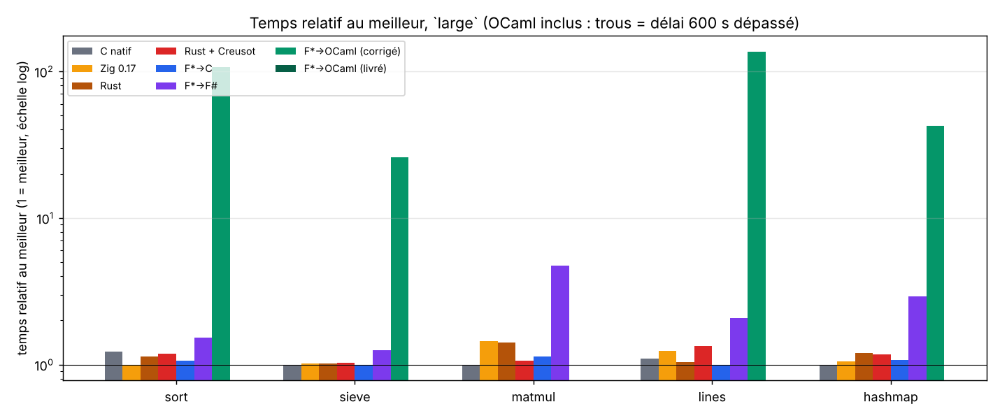

# Programmation vérifiée : F* (→ C, OCaml, F#) contre Rust + Creusot

Question : *« le code vérifié tient-il la route, en CPU, en RAM, en disque, et surtout en débit ? »*

Ce dépôt compare **huit colonnes**, sur **cinq workloads identiques** (spécification dans
[`spec/WORKLOADS.md`](spec/WORKLOADS.md)), avec un harnais de mesure externe (temps, CPU, pic RAM et courbe,
défauts de page, E/S disque, taille des binaires, coût de démarrage). Chaque colonne doit produire le **même
checksum** ; sinon le résultat est marqué ❌.

| colonne | source | vérifiée ? | extraction / compilation |
|---|---|---|---|
| `fstar-c` | `fstar/src/*.fst` (Pulse) | **oui (F\*)** | `fstar.exe --codegen C` → `gcc -O3` |
| `fstar-fsharp` | **les mêmes** sources F* | oui | `fstar.exe --codegen FSharp` → .NET 10 |
| `fstar-ocaml` / `fstar-ocaml-fast` | **les mêmes** sources F* | oui | `fstar.exe --codegen OCaml` → `ocamlopt` (runtime livré / conversions corrigées) |
| `rust-creusot` | `impls/rust` (Rust annoté Creusot) | **oui (Creusot)** | `cargo build --release` (les contrats sont effacés) |
| `rust-plain` | `impls/rust-plain` (Rust idiomatique, sans Creusot) | non | `cargo build --release` (opt 3, LTO, `panic=abort`) |
| `c-native` | `impls/c-native/bench.c` (C11 écrit à la main) | non | `gcc -O3 -std=c11` |
| `zig` | `impls/zig/bench.zig` (**Zig 0.17.0**, à la main) | non | `zig build-exe -O ReleaseFast -lc` |

Les trois colonnes **non vérifiées** (`rust-plain`, `c-native`, `zig`) sont des *références* demandées explicitement :
même algorithme, mêmes graines, même checksum, écrites sans preuve. Elles servent à répondre à « combien coûte le fait de
passer par F* ou par Creusot ? » en comparant à ce qu'on obtient sans. Les colonnes F* restent **100 % générées** (aucune
implémentation F* écrite à la main dans un autre langage).

## Réponses aux deux questions de fond

### « Pourquoi des implémentations à la main ? »

Dans une version précédente j'avais mis des ports « à la main » de F\* en OCaml/F#/C à la place des extractions ; vous aviez
(à raison) refusé : les colonnes F\* → C / F# / OCaml sont maintenant **toutes générées par F\*** à partir des mêmes
sources vérifiées. Les trois colonnes à la main d'aujourd'hui sont d'une autre nature, et demandées par vous : un **C natif**, un
**Zig 0.17** et un **Rust sans Creusot**, comme *références* de ce qu'un programmeur obtient sans vérification. Un seul
oracle de checksums existe aussi aux petites tailles ([`spec/checksums.json`](spec/checksums.json)).

### « Que veut dire Rust + contrats Creusot ? »

* **Creusot** est un outil de *vérification déductive* pour Rust. On écrit dans le code Rust des **contrats** :
  `#[requires(…)]` (précondition), `#[ensures(…)]` (postcondition), `#[invariant(…)]` (invariant de boucle),
  `#[variant(…)]` (terminaison), et des fonctions de spécification en logique (`#[logic]`). `cargo creusot`
  traduit le MIR en Why3/Coma, génère des obligations de preuve et les confie à des solveurs SMT
  (Alt-Ergo, Z3, CVC4/5).
* Un `cargo build` ordinaire **ignore** ces annotations : le binaire est du Rust normal. Le surcoût à l'exécution
  vient uniquement des choix de code que la preuve impose, jamais des preuves elles-mêmes.
* Ce qui est **réellement prouvé** ici (`make creusot`, voir « Niveau de preuve »): absence de panique et de
  débordement arithmétique pour tout le crate, terminaison de tout ce qui n'alloue pas, et — pour le tri —
  la **correction fonctionnelle complète** (le résultat est trié *et* est une permutation de l'entrée, rien
  d'autre n'est modifié). Les preuves sont exécutées (Alt-Ergo/Z3/CVC5) : un invariant affaibli fait échouer le
  but correspondant, je l'ai vérifié.
* Dans la version précédente du dépôt, les contrats étaient écrits mais **jamais prouvés** (Creusot n'était pas
  installé). Ce n'est plus le cas.

## Niveau de preuve (ce qui est démontré, et ce qui ne l'est pas)

| workload | F* (Pulse) | Rust (Creusot) |
|---|---|---|
| `sort` | **fonctionnel complet** : trié ∧ permutation ∧ cadre ; mémoire, débordements, terminaison | **fonctionnel complet** (idem) ; terminaison sauf l'allocation |
| `sieve` | mémoire sûre, indices, débordements, terminaison | idem |
| `matmul` | idem + indices non linéaires `i·n+j < n²` | idem |
| `lines` | idem ; l'analyseur est gardé par `p < len` | idem |
| `hashmap` | idem ; sondage borné par `cap` essais | idem |

**Limites assumées.** Hors du tri, je n'ai pas prouvé la correction « métier » (crible = nombres premiers,
produit matriciel = somme des produits, table = dictionnaire, analyse de lignes = somme par clé). Ce sont des
preuves de plusieurs jours chacune ; elles n'ajouteraient pas une instruction au code généré, seulement du temps
de preuve. Le checksum, comparé entre les huit colonnes, tient lieu de test de non-régression pour ces quatre-là.
Les corps de `mix64` et `ckfold` sont des opérations modulo 2^64 sans contrat.

## Ce que fait réellement F* 2026.10.25 (constats)

F* a changé : `LowStar.Buffer`/KaRaMeL ont disparu de la ulib ; la programmation de bas niveau passe par
**Pulse** (logique de séparation, `Pulse.Lib.Vec`, boucles `while` avec invariants) et l'extracteur
**Custard** (extraction « programme entier », monomorphisante).

* **C** : Custard produit directement du C11 autonome (boucles `while`, `malloc`/`free`, aucun runtime). Sur le
  tri et le crible, c'est exactement le C qu'on écrirait à la main.
* **F#** : les entiers machine deviennent les types .NET natifs (`uint32`, `uint64`, `byte[]`), sans bibliothèque de
  support. C'est le backend le plus proche du C en sémantique ; il refuse tout `Prims.int` à l'exécution.
* **OCaml** : le backend OCaml, lui, conserve le modèle de la bibliothèque F* : `FStar_SizeT.t` est un type boxé
  (`Sz of FStar_UInt64.t`, lui-même un `Stdint.Uint64.t`), les index passent par `Z.to_int (FStar_SizeT.v p)`,
  et **`FStar_UIntN.v` convertit l'entier en chaîne décimale puis la reparse avec Zarith**
  (`Prims.parse_int (M.to_string x)`), de même pour `uint_to_t`. C'est la cause principale de la lenteur : chaque
  accès tableau fait un aller-retour par une chaîne de caractères. D'où deux colonnes :
  * `fstar-ocaml` : runtime exactement tel que livré (compilé depuis `ulib/ml` ; les `.cmxa` précompilés exigent une
    variante exacte d'OCaml 5.3, rejetée par un OCaml standard) ;
  * `fstar-ocaml-fast` : **mêmes sources extraites**, seules `v` et `uint_to_t` remplacées par des conversions
    directes (`fstar/ocaml/build-ocaml.sh fast`).
  Un essai avec flambda (`-O3`) change les temps de ±20 % dans les deux sens : pas de colonne dédiée.
* **Bibliothèque** : la bibliothèque Pulse fournit un tri fusion vérifié (`Pulse.Lib.Sort.Merge.*`) et une table de
  hachage vérifiée (`Pulse.Lib.HashTable`). Je les ai examinées et **n'ai pas pu utiliser le tri** : sa
  spécification (`spec_merge`) renvoie `false` dès que deux éléments se comparent égaux, donc il ne trie que des
  clés toutes distinctes ; mon workload (8 M de u32 aléatoires) contient des doublons. J'ai donc écrit un tri
  fusion de même nature mais avec doublons. `Pulse.Lib.Vec`, `FStar.SizeT`, `FStar.Seq.Properties`
  (`permutation`, `append_permutations`, …) et `FStar.Math.Lemmas` sont, eux, utilisés.

## Mise en route

```bash
scripts/setup-fstar.sh      # F* 2026.10.25, .NET 10, switch opam OCaml 5.3 (stdint, zarith, ppx_deriving...)
scripts/setup-creusot.sh    # Creusot (clone, opam, solveurs, cargo-creusot)
scripts/setup-zig.sh        # Zig 0.17.0 (sha256 vérifié) dans /opt/tools/zig

scripts/build-all.sh        # Rust (x2), C natif, Zig + F* -> C, F#, OCaml ; écrit results/footprint.json
make creusot                # preuves Creusot (durée enregistrée)
fstar/build.sh verify       # preuves F* (durée enregistrée)

python3 harness/bench.py list
python3 harness/bench.py run --preset medium --repeat 3 --out results/run-medium.json  # + .md/.html/.csv
python3 harness/bench.py run --preset small --impls fstar-ocaml --timeout 600 --out results/run-small-fstar-ocaml.json
python3 harness/readme_tables.py     # régénère les tableaux de la section Résultats
```

Presets : `smoke`, `tiny`, `small`, `medium`, `large`, `xlarge` (voir `harness/presets.json`). Options :
`--repeat N`, `--timeout S`, `--impls a,b`, `--workloads w,…`, `--wrapper "taskset -c 2"` ou
`--wrapper "systemd-run --scope -p MemoryMax=2G --user"` pour plafonner la RAM.

## Organisation

```
spec/WORKLOADS.md        les 5 workloads (algorithmes, graines, checksums, tailles) ; spec/checksums.json
harness/bench.py         lanceur + mesures + rapport ; runner.c (fork/exec/wait4) ; impls.json ; presets.json
impls/rust               crate Rust + contrats Creusot (src/{common,sort,sieve,matmul,lines,hashmap}.rs)
impls/rust-plain         même algorithmes en Rust idiomatique, sans Creusot (src/main.rs)
impls/c-native           C11 écrit à la main (bench.c)
impls/zig                Zig 0.17 écrit à la main (bench.zig)
fstar/src                Bench.{Common,SortSpec,Sort,Sieve,Matmul,Lines,Hashmap,All}.fst(i) — Pulse
fstar/build.sh           verify -> extraction Custard -> C | F# | OCaml
fstar/ocaml/build-ocaml.sh   compile le code OCaml extrait avec le runtime F* (stock | fast)
fstar/drivers            pilotes C / F# / OCaml (parse des arguments, chronométrage, affichage)
scripts/                 installation et construction ; results/ : sorties
```

## Méthodologie de mesure

* **Débit** : mesuré *dans* le processus autour du calcul (hors démarrage du runtime) ; le démarrage est rapporté
  à part (run minuscule, médiane de 3).
* **CPU / RAM / disque** : mesurés par un petit lanceur C (`harness/runner.c`) qui fait `fork`/`exec`/`wait4`
  (user, sys, `ru_maxrss`, défauts de page, blocs E/S) plus un échantillonneur `/proc/<pid>` toutes les 20 ms
  (courbe de RSS). Le lanceur est nécessaire : `ru_maxrss` d'un enfant hérite du RSS du parent au `fork`, ce qui
  ajoutait ~15 Mo de plancher parasite quand le parent était l'interpréteur Python.
* **RAM/idéal** = pic RSS ÷ taille des structures de la spécification (voir `spec/WORKLOADS.md`).
* Médiane de N exécutions ; checksums vérifiés entre chaînes et contre `spec/checksums.json` (✅/❌).
* Limites : une VM de 4 cœurs, pas d'épinglage ni de gouverneur CPU figé ; les comparaisons relatives sont fiables à
  quelques pourcents, pas les valeurs absolues. Aucun workload ne lit de fichier : le « disque » est mesuré par les
  compteurs d'E/S du noyau (nuls) et par la taille des binaires/runtimes.
* Équité des compilateurs : `gcc -O3` (sans `-march=native`) pour le C extrait et le C natif ; Zig `-O ReleaseFast` (cible x86_64 générique, sans contrôles de bornes) ; `rustc -C opt-level=3 + LTO` ;
  `dotnet` Release (TieredPGO) ; `ocamlopt -inline 200 -unsafe` (sans flambda).

## Résultats

Machine : VM de 4 cœurs, 16 Go. Chaque cellule : débit · durée interne · pic RAM. `tiny`, `small`, `medium`, `large` : médiane de 3
exécutions (sauf OCaml : 1 exécution, timeout 600 s, épinglé sur un cœur avec `--wrapper "taskset -c N"` ; les deux OCaml tournaient en parallèle) ;
`xlarge` : 1 exécution (timeout 1800 s). **490 exécutions, 479 réussies, 11 sans résultat (timeouts OCaml et un échec F#), aucun
checksum divergent** entre colonnes ni avec la table de référence. Rapports complets : `results/run-*.{md,html,csv}`.

### `xlarge`

| workload (n) | C natif | Zig 0.17 | Rust | Rust + Creusot | F*→C | F*→F# |
|---|--:|--:|--:|--:|--:|--:|
| sort (100 000 000) | 6.20 M/s · 16.12 s · 764 Mo | 7.12 M/s · 14.04 s · 764 Mo | 6.00 M/s · 16.66 s · 765 Mo | 5.74 M/s · 17.41 s · 765 Mo | 6.64 M/s · 15.06 s · 764 Mo | 4.32 M/s · 23.14 s · 812 Mo |
| sieve (3 000 000 000) | 48.79 M/s · 61.48 s · 2862 Mo | 49.40 M/s · 60.73 s · 2863 Mo | 49.86 M/s · 60.17 s · 2863 Mo | 42.10 M/s · 71.26 s · 2863 Mo | 50.62 M/s · 59.26 s · 2862 Mo | **échec** |
| matmul (4 096) | 2.50 G/s · 27.53 s · 193 Mo | 1.14 G/s · 60.40 s · 194 Mo | 1.59 G/s · 43.14 s · 194 Mo | 2.87 G/s · 23.94 s · 194 Mo | 1.57 G/s · 43.90 s · 193 Mo | 513.56 M/s · 133.81 s · 351 Mo |
| lines (100 000 000) | 14.00 M/s · 7.14 s · 1336 Mo | 15.40 M/s · 6.49 s · 1336 Mo | 16.07 M/s · 6.22 s · 1337 Mo | 14.16 M/s · 7.06 s · 1337 Mo | 18.31 M/s · 5.46 s · 1336 Mo | 7.96 M/s · 12.56 s · 1609 Mo |
| hashmap (48 000 000) | 6.74 M/s · 21.38 s · 1025 Mo | 5.71 M/s · 25.22 s · 1026 Mo | 6.11 M/s · 23.58 s · 1026 Mo | 6.06 M/s · 23.76 s · 1026 Mo | 5.23 M/s · 27.53 s · 1026 Mo | 3.83 M/s · 37.56 s · 1187 Mo |

Moyenne géométrique du temps relatif au meilleur : C natif ×1.12 (5/5), Rust + Creusot ×1.16 (5/5), F*→C ×1.20 (5/5), Rust ×1.22 (5/5), Zig 0.17 ×1.29 (5/5), F*→F# ×2.47 (4/5).

### `large`

| workload (n) | C natif | Zig 0.17 | Rust | Rust + Creusot | F*→C | F*→F# | F*→OCaml (corrigé) | F*→OCaml (livré) |
|---|--:|--:|--:|--:|--:|--:|--:|--:|
| sort (32 000 000) | 5.98 M/s · 5.35 s · 246 Mo | 7.34 M/s · 4.36 s · 246 Mo | 6.44 M/s · 4.97 s · 246 Mo | 6.18 M/s · 5.18 s · 246 Mo | 6.91 M/s · 4.63 s · 246 Mo | 4.81 M/s · 6.66 s · 294 Mo | 68.88 k/s · 464.57 s · 1267 Mo | délai dépassé |
| sieve (1 000 000 000) | 53.45 M/s · 18.71 s · 955 Mo | 52.67 M/s · 18.98 s · 955 Mo | 52.72 M/s · 18.97 s · 956 Mo | 51.99 M/s · 19.23 s · 956 Mo | 53.44 M/s · 18.71 s · 955 Mo | 42.82 M/s · 23.35 s · 982 Mo | 2.05 M/s · 487.39 s · 7648 Mo | délai dépassé |
| matmul (2 500) | 3.39 G/s · 4.60 s · 73 Mo | 2.36 G/s · 6.62 s · 73 Mo | 2.41 G/s · 6.48 s · 73 Mo | 3.19 G/s · 4.89 s · 73 Mo | 3.00 G/s · 5.21 s · 73 Mo | 713.59 M/s · 21.90 s · 231 Mo | délai dépassé | délai dépassé |
| lines (40 000 000) | 15.05 M/s · 2.66 s · 545 Mo | 13.36 M/s · 2.99 s · 545 Mo | 16.00 M/s · 2.50 s · 545 Mo | 12.36 M/s · 3.24 s · 546 Mo | 16.57 M/s · 2.41 s · 545 Mo | 7.98 M/s · 5.01 s · 751 Mo | 121.47 k/s · 329.29 s · 6469 Mo | délai dépassé |
| hashmap (16 000 000) | 16.64 M/s · 2.89 s · 513 Mo | 15.78 M/s · 3.04 s · 514 Mo | 13.88 M/s · 3.46 s · 514 Mo | 14.19 M/s · 3.38 s · 514 Mo | 15.51 M/s · 3.10 s · 514 Mo | 5.69 M/s · 8.44 s · 675 Mo | 392.43 k/s · 122.31 s · 1259 Mo | délai dépassé |

Moyenne géométrique du temps relatif au meilleur : F*→C ×1.05 (5/5), C natif ×1.06 (5/5), Zig 0.17 ×1.14 (5/5), Rust ×1.15 (5/5), Rust + Creusot ×1.15 (5/5), F*→F# ×2.23 (5/5), F*→OCaml (corrigé) ×63.29 (4/5).

### `medium`

| workload (n) | C natif | Zig 0.17 | Rust | Rust + Creusot | F*→C | F*→F# | F*→OCaml (corrigé) | F*→OCaml (livré) |
|---|--:|--:|--:|--:|--:|--:|--:|--:|
| sort (8 000 000) | 6.21 M/s · 1.29 s · 63 Mo | 8.13 M/s · 0.98 s · 63 Mo | 6.60 M/s · 1.21 s · 63 Mo | 6.37 M/s · 1.26 s · 63 Mo | 7.40 M/s · 1.08 s · 62 Mo | 4.65 M/s · 1.72 s · 109 Mo | 85.29 k/s · 93.79 s · 322 Mo | délai dépassé |
| sieve (200 000 000) | 60.12 M/s · 3.33 s · 192 Mo | 60.00 M/s · 3.33 s · 192 Mo | 60.49 M/s · 3.31 s · 193 Mo | 59.55 M/s · 3.36 s · 193 Mo | 62.80 M/s · 3.18 s · 192 Mo | 46.41 M/s · 4.31 s · 219 Mo | 2.40 M/s · 83.31 s · 1536 Mo | 430.51 k/s · 464.56 s · 1592 Mo |
| matmul (1 600) | 3.19 G/s · 1.28 s · 31 Mo | 2.25 G/s · 1.82 s · 31 Mo | 2.59 G/s · 1.58 s · 31 Mo | 3.03 G/s · 1.35 s · 31 Mo | 3.20 G/s · 1.28 s · 31 Mo | 816.45 M/s · 5.02 s · 115 Mo | délai dépassé | délai dépassé |
| lines (10 000 000) | 11.54 M/s · 0.87 s · 149 Mo | 13.53 M/s · 0.74 s · 149 Mo | 16.06 M/s · 0.62 s · 150 Mo | 9.47 M/s · 1.06 s · 150 Mo | 12.16 M/s · 0.82 s · 149 Mo | 7.59 M/s · 1.32 s · 322 Mo | 132.24 k/s · 75.62 s · 1635 Mo | délai dépassé |
| hashmap (4 000 000) | 20.06 M/s · 0.60 s · 129 Mo | 18.02 M/s · 0.67 s · 130 Mo | 15.48 M/s · 0.78 s · 130 Mo | 15.61 M/s · 0.77 s · 130 Mo | 18.60 M/s · 0.65 s · 130 Mo | 5.99 M/s · 2.00 s · 291 Mo | 448.65 k/s · 26.75 s · 320 Mo | 61.42 k/s · 195.39 s · 347 Mo |

Moyenne géométrique du temps relatif au meilleur : F*→C ×1.09 (5/5), C natif ×1.14 (5/5), Zig 0.17 ×1.15 (5/5), Rust ×1.15 (5/5), Rust + Creusot ×1.25 (5/5), F*→F# ×2.31 (5/5), F*→OCaml (corrigé) ×60.67 (4/5), F*→OCaml (livré) ×218.28 (2/5).

### `small`

| workload (n) | C natif | Zig 0.17 | Rust | Rust + Creusot | F*→C | F*→F# | F*→OCaml (corrigé) | F*→OCaml (livré) |
|---|--:|--:|--:|--:|--:|--:|--:|--:|
| sort (1 000 000) | 7.21 M/s · 0.14 s · 9 Mo | 8.66 M/s · 0.12 s · 9 Mo | 7.75 M/s · 0.13 s · 10 Mo | 7.53 M/s · 0.13 s · 10 Mo | 7.65 M/s · 0.13 s · 9 Mo | 3.16 M/s · 0.32 s · 63 Mo | 106.57 k/s · 9.38 s · 46 Mo | 14.85 k/s · 67.36 s · 58 Mo |
| sieve (20 000 000) | 135.27 M/s · 0.15 s · 21 Mo | 149.44 M/s · 0.13 s · 21 Mo | 135.93 M/s · 0.15 s · 21 Mo | 147.97 M/s · 0.14 s · 21 Mo | 148.78 M/s · 0.13 s · 21 Mo | 92.31 M/s · 0.22 s · 48 Mo | 2.68 M/s · 7.45 s · 160 Mo | 479.79 k/s · 41.68 s · 165 Mo |
| matmul (512) | 4.29 G/s · 0.03 s · 4 Mo | 2.70 G/s · 0.05 s · 5 Mo | 2.75 G/s · 0.05 s · 5 Mo | 3.85 G/s · 0.03 s · 5 Mo | 3.85 G/s · 0.03 s · 4 Mo | 422.28 M/s · 0.32 s · 37 Mo | 4.18 M/s · 32.14 s · 77 Mo | 668.22 k/s · 200.86 s · 81 Mo |
| lines (1 000 000) | 7.26 M/s · 0.14 s · 31 Mo | 10.14 M/s · 0.10 s · 31 Mo | 10.00 M/s · 0.10 s · 31 Mo | 7.82 M/s · 0.13 s · 31 Mo | 9.15 M/s · 0.11 s · 31 Mo | 4.99 M/s · 0.20 s · 151 Mo | 128.38 k/s · 7.79 s · 184 Mo | 13.82 k/s · 72.37 s · 197 Mo |
| hashmap (500 000) | 29.99 M/s · 0.05 s · 17 Mo | 31.52 M/s · 0.05 s · 18 Mo | 26.27 M/s · 0.06 s · 18 Mo | 23.53 M/s · 0.06 s · 18 Mo | 28.51 M/s · 0.05 s · 18 Mo | 6.67 M/s · 0.22 s · 171 Mo | 518.71 k/s · 2.89 s · 47 Mo | 66.34 k/s · 22.61 s · 50 Mo |

Moyenne géométrique du temps relatif au meilleur : F*→C ×1.09 (5/5), Zig 0.17 ×1.10 (5/5), C natif ×1.14 (5/5), Rust + Creusot ×1.18 (5/5), Rust ×1.18 (5/5), F*→F# ×3.37 (5/5), F*→OCaml (corrigé) ×117.42 (5/5), F*→OCaml (livré) ×835.33 (5/5).

### `tiny`

| workload (n) | C natif | Zig 0.17 | Rust | Rust + Creusot | F*→C | F*→F# | F*→OCaml (corrigé) | F*→OCaml (livré) |
|---|--:|--:|--:|--:|--:|--:|--:|--:|
| sort (200 000) | 8.92 M/s · 0.02 s · 3 Mo | 10.83 M/s · 0.02 s · 3 Mo | 8.62 M/s · 0.02 s · 3 Mo | 8.48 M/s · 0.02 s · 3 Mo | 10.01 M/s · 0.02 s · 3 Mo | 1.41 M/s · 0.14 s · 48 Mo | 123.11 k/s · 1.62 s · 15 Mo | 16.34 k/s · 12.24 s · 17 Mo |
| sieve (5 000 000) | 149.35 M/s · 0.03 s · 6 Mo | 162.05 M/s · 0.03 s · 6 Mo | 158.15 M/s · 0.03 s · 7 Mo | 160.61 M/s · 0.03 s · 7 Mo | 177.09 M/s · 0.03 s · 6 Mo | 104.13 M/s · 0.05 s · 33 Mo | 2.88 M/s · 1.74 s · 45 Mo | 489.85 k/s · 10.21 s · 47 Mo |
| matmul (128) | 2.31 G/s · 0.00 s · 2 Mo | 1.64 G/s · 0.00 s · 2 Mo | 3.16 G/s · 0.00 s · 2 Mo | 2.64 G/s · 0.00 s · 2 Mo | 3.07 G/s · 0.00 s · 2 Mo | 84.84 M/s · 0.02 s · 29 Mo | 3.88 M/s · 0.54 s · 10 Mo | 720.44 k/s · 2.91 s · 12 Mo |
| lines (50 000) | 1.73 M/s · 0.03 s · 18 Mo | 1.68 M/s · 0.03 s · 18 Mo | 1.98 M/s · 0.03 s · 19 Mo | 1.95 M/s · 0.03 s · 19 Mo | 2.16 M/s · 0.02 s · 18 Mo | 1.46 M/s · 0.03 s · 50 Mo | 65.64 k/s · 0.76 s · 31 Mo | 6.60 k/s · 7.57 s · 32 Mo |
| hashmap (100 000) | 30.80 M/s · 0.01 s · 5 Mo | 39.80 M/s · 0.01 s · 5 Mo | 35.51 M/s · 0.01 s · 6 Mo | 37.79 M/s · 0.01 s · 6 Mo | 44.16 M/s · 0.01 s · 5 Mo | 4.73 M/s · 0.06 s · 58 Mo | 538.82 k/s · 0.56 s · 16 Mo | 69.80 k/s · 4.30 s · 16 Mo |

Moyenne géométrique du temps relatif au meilleur : F*→C ×1.02 (5/5), Rust ×1.14 (5/5), Rust + Creusot ×1.17 (5/5), Zig 0.17 ×1.25 (5/5), C natif ×1.29 (5/5), F*→F# ×5.83 (5/5), F*→OCaml (corrigé) ×103.50 (5/5), F*→OCaml (livré) ×736.97 (5/5).


Les moyennes géométriques avec « (4/5) » ou « (2/5) » ne portent que sur les workloads terminés : elles ne sont pas comparables aux autres.

## Synthèse des performances et graphes

Temps relatif au meilleur de la ligne, taille `large` (1,00 = meilleur ; « > 600 s » = délai dépassé, pas de résultat) :

| workload | C natif | Zig 0.17 | Rust | Rust + Creusot | F*→C | F*→F# | F*→OCaml (corrigé) | F*→OCaml (livré) |
|---|--:|--:|--:|--:|--:|--:|--:|--:|
| sort | ×1.23 | ×1.00 | ×1.14 | ×1.19 | ×1.06 | ×1.53 | ×106.52 | > 600 s |
| sieve | ×1.00 | ×1.01 | ×1.01 | ×1.03 | ×1.00 | ×1.25 | ×26.05 | > 600 s |
| matmul | ×1.00 | ×1.44 | ×1.41 | ×1.06 | ×1.13 | ×4.76 | > 600 s | > 600 s |
| lines | ×1.10 | ×1.24 | ×1.04 | ×1.34 | ×1.00 | ×2.08 | ×136.38 | > 600 s |
| hashmap | ×1.00 | ×1.05 | ×1.20 | ×1.17 | ×1.07 | ×2.93 | ×42.39 | > 600 s |

Graphes (générés par `python3 harness/charts.py`, source : `results/run-*.json`) :

1. **Temps relatif au meilleur, `large`, hors OCaml** : montre que les cinq colonnes natives/vérifiées sont dans un mouchoir et que seul F# s'en détache.
   
2. **Même graphe, OCaml inclus (échelle log)** : l'écart de deux ordres de grandeur du backend OCaml.
   
3. **Débit en fonction de la taille** : un panneau par workload ; courbes plates = pas de dégradation avec la charge ; les courbes OCaml s'arrêtent où le délai est dépassé.
   
4. **Mémoire à `large`** (pic RAM ÷ taille des structures, échelle log) : C/Zig/Rust à ~1, .NET entre 1,2 et 3, OCaml jusqu'à 8.
   
5. **Coût de la vérification** : le prix de la preuve, payé hors exécution.
   

### Ce que disent ces chiffres (et ce qu'ils ne disent pas)

* **Le code vérifié ne coûte rien de mesurable face au code à la main, en C comme en Rust.** À `large`, moyenne géométrique du temps
  relatif au meilleur : F*→C ×1,05, C natif ×1,06, Zig ×1,14, Rust ×1,15, Rust + Creusot ×1,15. À `xlarge` : C natif ×1,12, Rust + Creusot ×1,16,
  F*→C ×1,20, Rust ×1,22, Zig ×1,29. Les écarts de ±10 % entre ces cinq colonnes changent d'ordre d'une taille à l'autre et d'un
  workload à l'autre (une seule exécution à `xlarge`) : c'est du bruit de VM et de choix du compilateur, pas un coût de la preuve.
* **Le Rust sans Creusot n'est pas plus rapide que le Rust avec Creusot** (×1,15 contre ×1,15 à `large`, ×1,22 contre ×1,16 à `xlarge`) : les
  contrats sont effacés, les deux binaires ont la même taille (~394 Ko). Les différences viennent du code (boucles indicées pour
  la preuve contre itérateurs `zip` dans la version simple), pas des contrats.
* **`matmul` est le seul workload où les colonnes se séparent nettement** : à `xlarge` Rust + Creusot (2,87 G/s) et C natif (2,50 G/s) devancent
  Rust simple (1,59), F*→C (1,57) et Zig (1,14). Ce sont des écarts de *vectorisation* par le compilateur (cible x86-64 générique, sans
  `-march=native`) sur une boucle `i-k-j` identique ; je n'ai pas inspecté l'assembleur, la cause exacte est donc une hypothèse. Le Zig
  est ici la colonne la plus lente des cinq — hypothèse non mesurée : LLVM ne prouve pas l'absence d'aliasing entre les tranches `c` et `b`.
* **Zig 0.17 (ReleaseFast) est au niveau du C** sur `sort`, `sieve`, `lines`, `hashmap` (premier sur `sort` à toutes les tailles ; écart au meilleur ≤ ×1,25 à `large` sur les quatre), moins bon sur `matmul` (voir ci-dessus).
* **F* → F# est ~2,2× plus lent que C** en moyenne (de 1,25× sur `sieve` à ~4,8× sur `matmul` ; ~2,9× sur `hashmap`, ~2,1× sur `lines`, à `large`), avec 1,2 à 3× plus
  de RAM (tableaux .NET et GC) et ~30 Mo / ~75 ms de démarrage du runtime. **Échec à `xlarge`/`sieve`** (3 milliards d'octets) : le backend F#
  convertit la taille en `int` 32 bits (`Array.create` reçoit `-1294967295`) et lève une exception ; un tableau de plus de 2³¹−1 éléments ne
  peut donc pas être alloué par le code extrait. Le C extrait le fait sans souci (2,86 Go).
* **F* → OCaml n'est pas utilisable pour de la charge** avec ce backend : entiers boxés, `FStar_SizeT` boxé, et pour le runtime livré un
  aller-retour par une chaîne décimale à chaque accès tableau. Avec le runtime livré, seul `tiny` passe en totalité (12 s pour trier 200 000
  éléments, C : 0,02 s) ; à `medium` seuls `sieve` (465 s) et `hashmap` (195 s) terminent avant 600 s ; à `large` rien ne termine. Corriger
  seulement `v`/`uint_to_t` apporte un facteur 5,6 à 9,3 (`small`) : `medium` termine pour 4 workloads sur 5 (`sort` 94 s contre 1,1 s en C) ; `large`
  termine `sort` (465 s), `sieve` (487 s), `lines` (329 s), `hashmap` (122 s) mais pas `matmul` (> 600 s), soit ×26 (`sieve`) à ×140 (`lines`) le temps du C à `large` (×57 à ×1000 à `small`).
* **Mémoire** : C, Zig et Rust sont à ~1,0× la taille des structures ; .NET ajoute ~30 Mo de runtime et 1,2 à 3× sur les tableaux ; l'OCaml extrait
  consomme jusqu'à ~8× (crible `large` : 7,6 Go pour 1 Go de données, un mot par octet dans un tableau générique), ~5× sur `sort`.
* **Disque** : les binaires pèsent 20 Ko (F*→C et C natif), 66 Ko (Zig), ~390 Ko (Rust, deux versions) ; F# 50 Ko + 74 Mo de runtime .NET à
  installer ; OCaml ~5 Mo. Aucun workload ne lit de fichier ; les compteurs d'E/S du noyau sont nuls partout (sauf quelques blocs écrits côté .NET).
* **Coût de la preuve** (le vrai prix de la programmation vérifiée) : vérification **à froid** de tous les modules F* : **154 à 236 s** selon
  la charge de la machine (236 s mesurés lors de la dernière reconstruction complète) ; preuves Creusot du crate Rust, sans cache : **16 s**.
  Ces durées ne changent pas une instruction de code généré.
* Ce que cette étude **ne montre pas** : l'effet de preuves fonctionnelles plus fortes (seul le tri en a), l'effet d'un autre compilateur C
  ou d'`-march=native`, et la variabilité entre machines. Une VM partagée : seuls les écarts ≳ 15 % sont à prendre au sérieux.

## Ce qui a été exécuté

Tout ce qui est décrit ci-dessus a été exécuté sur cette machine : `make build` (construction des 8 colonnes), `make fstar-verify`
(tous les modules F*, à froid : 236 s), `make creusot` (36 fichiers prouvés), `make list`, `make bench`, les six presets
(`smoke`, `tiny`, `small`, `medium`, `large`, `xlarge`) pour toutes les colonnes qui en sont capables, l'option `--wrapper` (`taskset -c N`
pour les runs OCaml), et les trois scripts d'installation (`setup-zig.sh` : téléchargement + sha256 vérifiés ; `setup-fstar.sh` dans un préfixe vierge ;
`setup-creusot.sh` sur un clone vierge). Ce qui n'a **pas** de résultat : OCaml aux tailles où il dépasse 600 s (« délai dépassé »,
colonnes concernées dans les tableaux), l'OCaml livré n'ayant été lancé ni à `xlarge` ni avec plus d'une exécution, et `fstar-fsharp`/`sieve` à `xlarge` (échec, ci-dessus).
`xlarge` pour les deux OCaml n'a pas été tenté : `large` ne termine déjà pas.

## Suite logique

1. **Preuves « métier » au-delà du tri.** Seul le tri a une correction fonctionnelle complète. J'ai essayé le produit
   matriciel en Creusot : le contrat de la boucle interne (`loop_j` : la ligne `i` est mise à jour, tout le reste est
   inchangé, `c'[i·n+j] ≡ c[i·n+j] + aik·b[k·n+j] mod 2³²`) se prouve, mais la composition dans `loop_k` bute sur un
   raisonnement de congruence modulaire que les solveurs ne retrouvent pas sans lemme d'instanciation ; je n'ai rien
   livré de partiellement prouvé. Les autres cibles naturelles : le crible (`f[i]==0 ⇔ i premier`), l'agrégation de
   `lines` (aller-retour décimal), la table (modèle dictionnaire). Elles n'ajouteraient aucune instruction au code
   généré — seulement du temps de preuve, ce qui est justement la mesure qui manque ici.
2. **Mesurer la valeur des gardes.** Plusieurs endroits du code F* utilisent une garde runtime (`p < len` dans l'analyseur,
   `if s < cap` dans la table) là où une preuve supplémentaire permettrait de s'en passer ; l'écart avec une version
   entièrement prouvée serait un chiffre intéressant.
3. **Runtime OCaml.** Réaliser `FStar_UInt64`/`FStar_SizeT` par des `int` natifs serait un meilleur point de comparaison que
   la colonne « conversions corrigées » ; ce n'est pas ce que livre F*, donc je ne l'ai pas fait.
4. **Autres machines / compilateurs** (clang, `-march=native`, Rust nightly, .NET en AOT, `zig cc`) pour valider les écarts de quelques pourcents, et comprendre l'écart de `matmul` (assembleur).
